<div align="center">

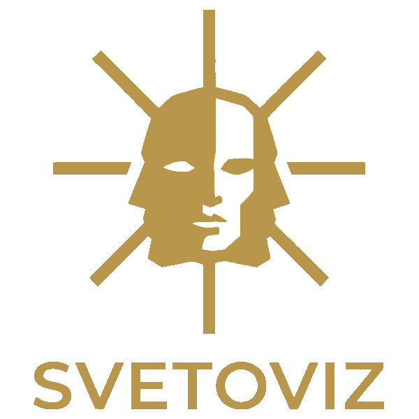

### High-dimensional data visualization for NumPy, PyTorch, Hugging Face datasets and entire neural networks.

**Svetoviz is a debug viewer for tensors, images, NumPy arrays, datasets and PyTorch models.** It ships as two
applications that share one Python API and one mapping implementation: a custom **WebGPU renderer** that renders
entire models and datasets in the browser, and a native **OpenGL desktop app** for local inspection. Both
include a **PyTorch debugger** that traces the *input -> weights -> output* relation of every basic `torch.nn`
module.

[](https://www.svetoviz.com)
[](https://www.svetoviz.com/docs)
[](https://pytorch.svetoviz.com)
[](#2-installation-and-quick-start)
[](#2-installation-and-quick-start)
[](#2-installation-and-quick-start)
[](#1-overview)
[](#11-pytorch-modules-and-debugger)

**[Website](https://www.svetoviz.com)** &nbsp;|&nbsp; **[Documentation](https://www.svetoviz.com/docs)** &nbsp;|&nbsp; **[Install](#2-installation-and-quick-start)**

</div>

---

## Table of Contents

- [1. Overview](#1-overview)
    - [What you can build](#what-you-can-build)
    - [Two renderers, one API](#two-renderers-one-api)
    - [Architecture](#architecture)
    - [Repository layout](#repository-layout)
- [2. Installation and Quick Start](#2-installation-and-quick-start)
    - [OpenGL installation](#opengl-installation)
    - [WebGPU installation](#webgpu-installation)
    - [Both renderers in one environment](#both-renderers-in-one-environment)
    - [Cache setup](#cache-setup)
    - [Demos](#demos)
- [3. API Reference](#3-api-reference)
    - [Desktop methods](#desktop-methods)
    - [Web methods](#web-methods)
    - [WebConfig](#webconfig)
    - [Views classes](#views-classes)
    - [Layouts classes](#layouts-classes)
    - [Remote views](#remote-views)
    - [Utilities](#utilities)
    - [Terminal buffer helpers](#terminal-buffer-helpers)
    - [Supported dtypes](#supported-dtypes)
- [4. Images](#4-images)
    - [Single image rendering](#single-image-rendering)
    - [Batch image inspection](#batch-image-inspection)
    - [Cache and performance](#cache-and-performance)
- [5. NumPy](#5-numpy)
    - [Single array inspection](#single-array-inspection)
    - [Dimensional stacking and colormaps](#dimensional-stacking-and-colormaps)
    - [Visualizing multiple data types](#visualizing-multiple-data-types)
    - [Axis ordering and spatial mapping](#axis-ordering-and-spatial-mapping)
    - [High-dimensional large arrays](#high-dimensional-large-arrays)
- [6. Datasets](#6-datasets)
    - [Building a dataset scene](#building-a-dataset-scene)
    - [Starting the dataset](#starting-the-dataset)
    - [Building the search database](#building-the-search-database)
    - [Compression and performance](#compression-and-performance)
- [7. Views and Layouts](#7-views-and-layouts)
    - [Views and layouts](#views-and-layouts)
    - [NumpyView](#numpyview)
    - [ImageView](#imageview)
    - [DirectoryGridView](#directorygridview)
    - [DirectorySpiralView](#directoryspiralview)
    - [DatasetView](#datasetview)
    - [VerticalLayout](#verticallayout)
    - [HorizontalLayout](#horizontallayout)
    - [GridLayout](#gridlayout)
    - [Nesting layouts](#nesting-layouts)
    - [Offline scene building](#offline-scene-building)
- [8. torch.Tensor](#8-torchtensor)
    - [Single torch.Tensor inspection](#single-torchtensor-inspection)
    - [Visualizing multiple tensor dtypes](#visualizing-multiple-tensor-dtypes)
    - [Axis ordering for tensors](#axis-ordering-for-tensors)
- [9. Models](#9-models)
    - [GPT-2 terminal callback](#gpt-2-terminal-callback)
    - [DETR terminal callback](#detr-terminal-callback)
    - [Non-blocking mode](#non-blocking-mode)
    - [Diffusion pipeline](#diffusion-pipeline)
    - [Static model views](#static-model-views)
    - [Renderer settings](#renderer-settings)
- [10. Python App and Desktop App (OpenGL)](#10-python-app-and-desktop-app-opengl)
    - [Local 2D rendering](#local-2d-rendering)
    - [Explicit layout control](#explicit-layout-control)
    - [Image layouts](#image-layouts)
    - [Saving and loading](#saving-and-loading)
    - [Datasets](#datasets)
    - [PyTorch module inspection](#pytorch-module-inspection)
    - [Interactive models](#interactive-models)
- [11. PyTorch Modules and Debugger](#11-pytorch-modules-and-debugger)
    - [Interactive modules](#interactive-modules)
    - [Layer relations](#layer-relations)
    - [Module catalog](#module-catalog)
- [12. Try Svetoviz Now](#12-try-svetoviz-now)
- [13. Documentation Index](#13-documentation-index)
    - [Video demos](#video-demos)
- [14. Links](#14-links)
- [15. About](#15-about)

> Every section below mirrors the matching page of the documentation site (https://www.svetoviz.com/docs) one to one, in the same order. The section-to-page mapping, including the two reference scripts, is listed in [Documentation Index](#13-documentation-index).

---

## 1. Overview

Svetoviz is a high-dimensional data visualization engine. It ships with a custom WebGPU renderer that renders entire models and datasets in the browser, and a Python package (`svetoviz`) that lets you build your own visualizations with your own data.

Your Python process builds a scene out of **Views** (data sources) and **Layouts** (spatial containers) and hands it to a renderer. Values are never flattened into a print statement or a single 2D image: every element gets a position in 3D space, and you navigate that space.

### What you can build

- **Model visualization:** render entire models and datasets in the browser via the custom WebGPU renderer, or open the scene directly from the public spaces directory.
- **Dataset browser:** visualize large datasets in the browser, or open the scene directly from the public spaces directory.
- **PyTorch Debugger:** track the input -> weights -> output relations for every basic PyTorch module.
- **Your own data:** build views from your own models, datasets and NumPy arrays with the Python package and open them in the browser - the renderer runs locally, no account needed.

### Two renderers, one API

<a id="compatibility"></a>

| | Package | Renders in | macOS (Apple Silicon) | Linux | Python |
|---|---|---|:---:|:---:|---|
| **WebGPU app** | `svetoviz_webgpu` | A modern browser (Chrome / Chromium WebGPU) | Yes | Yes (`x86_64` / `aarch64`) | **3.9 - 3.14** |
| **OpenGL app** | `svetoviz_opengl` | A native desktop window | Yes | No | **3.9 - 3.12** |

Both packages expose the same surface - `sv.array`, `sv.tensor`, `sv.image`, `sv.view`, `sv.pytorch`, `sv.model`, `sv.pipeline`, `sv.save_to_disc`, `sv.load_from_disc` - and share a single mapping implementation, so a scene built for one renderer behaves identically in the other.

- The **OpenGL app** is written in pure OpenGL. It focuses on clear perspective over immersion: fast, local, no server, no browser.
- The **WebGPU app** streams the scene to a browser tab and renders it client-side with a custom WebGPU pipeline.

### Architecture

```
your python process                         renderer                        user
---------------------                       --------                        ----
numpy / torch / PIL / HF dataset
        |
        +-- Views (NumpyView, TensorView, DatasetView, ModelView, ...)
        |
        +-- Layouts (Vertical / Horizontal / Grid / Directory / Spiral)
        |
        +-- sv.view(scene)  ------------->  WebGPU  (browser)  --------->  3D scene
                                     +---->  OpenGL  (desktop)  --------->  window

sv.save_to_disc(scene) --> tiles + tree.db --> sv.build_pmtiles_file() --> remote URL
```

This README mirrors the documentation site section by section. Every code block below is taken from the corresponding documentation page or from the two reference scripts in this repository.

### Repository layout

```
.
|-- README.md                       # this document (GitHub landing page)
|-- app.py                          # local preview renderer for README.md (not part of the package)
|-- examples/
|   |-- quickstart_webgpu.py        # reference script for svetoviz_webgpu
|   `-- quickstart_opengl.py        # reference script for svetoviz_opengl
`-- assets/
    `-- images/                     # every screenshot embedded in this README
```

---

## 2. Installation and Quick Start

Svetoviz is currently distributed via a private repository. Both packages are installed from their own wheel indexes.

### OpenGL installation

You can install the OpenGL app using the following command:

```bash
pip install svetoviz_opengl --extra-index-url https://svetoviz.com/opengl/simple/
```

**Compatibility:** this package supports **macOS (Apple Silicon)** and Python versions **3.9 through 3.12**.

Dependencies installed with the OpenGL app:

```python
dependencies = [
    "opencv-python==4.13.0.92",
    "matplotlib==3.9.4",
    "transformers==4.57.6",
    "datasets==4.5.0",
    "glfw==2.10.0",
    "imgui==2.0.0",
    "PyOpenGL==3.1.10",
    "psutil==7.2.2",
    "psd-tools==1.11.0",
    "torch==2.8.0; python_version == '3.9'",
    "torch==2.13.0; python_version >= '3.10'"
]
```

**Quick start:** download [`examples/quickstart_opengl.py`](examples/quickstart_opengl.py) for the full reference script. The minimal starting point from that file:

```python
# examples/quickstart_opengl.py
import os

current_dir = os.path.dirname(os.path.abspath(__file__))
cache_dir = os.path.join(current_dir, "cache_test")
os.environ["SVETO_VIZ_CACHE_DIR"] = cache_dir

import svetoviz_opengl as sv
import numpy as np

print(f"Cache dir: {sv.get_cache_dir()}")

data = np.random.rand(4, 4, 32, 32).astype(np.float32)
sv.array(data, gap_size=10)
```

### WebGPU installation

You can install the WebGPU app using the following command:

```bash
pip install svetoviz_webgpu --extra-index-url https://svetoviz.com/webgpu/simple/
```

**Compatibility:** this package supports **macOS (Apple Silicon), Linux** and Python versions **3.9 through 3.14**.

Dependencies installed with the WebGPU app:

```python
dependencies = [
    "Flask==3.1.3",
    "waitress==3.0.2",
    "opencv-python==4.13.0.92",
    "transformers==4.57.6",
    "datasets==4.5.0",
    "psd-tools==1.11.0",
    "pmtiles==3.7.0",
    "websockets==15.0.1",
    "petname==2.9",
    "torch==2.8.0; python_version == '3.9'",
    "torch==2.13.0; python_version >= '3.10'"
]
```

**Quick start:** download [`examples/quickstart_webgpu.py`](examples/quickstart_webgpu.py) for the full reference script. The minimal starting point from that file:

```python
# examples/quickstart_webgpu.py
import os

current_dir = os.path.dirname(os.path.abspath(__file__))
cache_dir = os.path.join(current_dir, "cache_test")
os.environ["SVETO_VIZ_CACHE_DIR"] = cache_dir

import svetoviz_webgpu as sv
import numpy as np

print(f"Cache dir: {sv.get_cache_dir()}")

data = np.random.rand(4, 4, 32, 32).astype(np.float32)
sv.array(data, gap_size=10)  # opens http://localhost:8000
```

### Both renderers in one environment

Both apps can coexist in a single virtual environment. Select your preferred renderer by choosing the import:

```python
import svetoviz_opengl as svo
import svetoviz_webgpu as svw

data = np.random.rand(4, 4, 32, 32).astype(np.float32)

# OpenGL renderer
svo.array(data, gap_size=10)

# WebGPU renderer
svw.array(data, gap_size=10)
```

### Cache setup

Cache data is written to `SVETO_VIZ_CACHE_DIR`. Set the variable **before** importing svetoviz, otherwise cache data gets stored inside site packages:

```python
import os

current_dir = os.path.dirname(os.path.abspath(__file__))
cache_dir = os.path.join(current_dir, "cache_test")
os.environ["SVETO_VIZ_CACHE_DIR"] = cache_dir

import svetoviz_webgpu as sv

# Verify the cache
print(f"Cache dir: {sv.get_cache_dir()}")
```

The same block works for `svetoviz_opengl`.

### Demos

Run the demo to verify the WebGPU installation:


```python
import svetoviz_webgpu as sv

# Run web demo
sv.demo_array()

# Run web pytorch demo
sv.demo_modules()
```

`sv.demo_modules()` opens a collection of all supported PyTorch modules. Pass any string into the terminal view to process them, then use the timeline view to walk through the activations.

---

### Free to use

Both apps are free to use

---


## 3. API Reference

Method definitions and parameter specifications for both libraries. The OpenGL app follows the WebGPU interface, with the desktop signatures being a subset (no network arguments).

### Desktop methods

`svetoviz_opengl`

| Signature | Notes |
|---|---|
| `array(cls, np_array, gap_size=0, ordering=None)` | Visualize a single NumPy array |
| `arrays(cls, arrays, gap_size=0)` | Visualize a list of NumPy arrays |
| `tensor(cls, tensor, gap_size=0, ordering=None)` | Visualize a single `torch.Tensor` |
| `tensors(cls, tensors, gap_size=0)` | Visualize a list of tensors |
| `image(cls, image)` | Visualize one image (URL / path / PIL) |
| `images(cls, images)` | Visualize a list of images |
| `pytorch(cls, module, terminal_callback=None)` | Attach the debugger to a `nn.Module` |
| `model(cls, id, model, tokenizer=None, image_processor=None, video_processor=None, processor=None, scheduler=None, feature_extractor=None, terminal_callback=None)` | Attach the debugger to a Hugging Face model |
| `pipeline(cls, id, pipe, terminal_callback=None)` | Attach the debugger to a pipeline |
| `view(cls, view)` | Open a View or Layout instance |
| `save_to_disc(cls, view, directory, threaded=True, max_memory_gb=2, image_backend="pillow", compression="png_0")` | Build a scene offline |
| `load_from_disc(cls, directory)` | Open a previously built scene |

**Parameter notes**

- `gap_size` - integer spacing between visualized slices. Default `0`.
- `ordering` - tuple or list defining the axis permutation, identical to `numpy.transpose`. The visualizer treats the **last two dimensions** as width and height, so arrays in `(H, W, C)` layout appear distorted and must be reordered, e.g. `ordering=(2, 0, 1)`.
- `image` - accepts a URL string, a local file path, or a Pillow `Image` instance.

### Web methods

`svetoviz_webgpu` - identical to the desktop surface plus networking:

| Signature |
|---|
| `array(cls, np_array, gap_size=0, ordering=None, host="localhost", http_port=8000, ws_port=8765, config=None)` |
| `arrays(cls, arrays, gap_size=0, host="localhost", http_port=8000, ws_port=8765, config=None)` |
| `tensor(cls, tensor, gap_size=0, ordering=None, host="localhost", http_port=8000, ws_port=8765, config=None)` |
| `tensors(cls, tensors, gap_size=0, host="localhost", http_port=8000, ws_port=8765, config=None)` |
| `image(cls, image, host="localhost", http_port=8000, ws_port=8765, config=None)` |
| `images(cls, images, host="localhost", http_port=8000, ws_port=8765, config=None)` |
| `pytorch(cls, module, terminal_callback=None, host="localhost", http_port=8000, ws_port=8765, blocking=True, config=None)` |
| `model(cls, id, model, tokenizer=None, image_processor=None, video_processor=None, processor=None, scheduler=None, feature_extractor=None, terminal_callback=None, host="localhost", http_port=8000, ws_port=8765, blocking=True, config=None)` |
| `pipeline(cls, id, pipe, terminal_callback=None, host="localhost", http_port=8000, ws_port=8765, blocking=True, config=None)` |
| `view(cls, view, terminal_callback=None, host="localhost", http_port=8000, ws_port=8765, config=None)` |
| `save_to_disc(cls, view, directory, threaded=True, max_memory_gb=2, image_backend="pillow", compression="png_0")` |
| `load_from_disc(cls, directory, host="localhost", http_port=8000, ws_port=8765, config=None)` |
| `build_pmtiles_file(cls, directory)` |
| `demo_array(cls, host="localhost", http_port=8000)` |
| `demo_modules(cls, host="localhost", http_port=8000)` |

### WebConfig

Every web method accepts an optional `config=WebConfig()` argument that controls the rendering of the scene:

```python
class WebConfig:
    def __init__(self,
                 # scene description
                 description=None,
                 # Theme name, "Light" "Dark" "Darker"
                 default_theme="Dark",
                 # groups rendering mode, "lines", "none"
                 groups_mode="lines",
                 # matrix mode (values up close), "quads", "cubes", "diamonds", "spheres"
                 matrix_mode="quads",
                 # stream values (local only) - stream values on mouse hover
                 stream_values=True,
                 # terminal and timeline - enable/disable terminal and timeline view
                 terminal_enabled=True,
                 # render labels - enable/disable TextViews.
                 render_labels=True
                 ):
```

### Views classes

<a id="views-classes-table"></a>

| Class | Signature |
|---|---|
| `NumpyView` | `__init__(self, id, data, gap_size=1, ordering=None, description=None)` |
| `TensorView` | `__init__(self, id, data, gap_size=1, ordering=None, description=None)` |
| `LazyImageView` | `__init__(self, id, image, description=None)` |
| `DiscImageView` | `__init__(self, id, image, description=None)` |
| `DirectoryGridView` | `__init__(self, id, directory, lazy=False, limit=None)` |
| `DirectorySpiralView` | `__init__(self, id, directory, lazy=False, limit=None)` |
| `DatasetView` | `__init__(self, id, dataset, image_columns, info_columns, cell_width, cell_height, image_backend, info_column_mapping_func)` |
| `ModelView` | `__init__(self, id, model, tokenizer=None, image_processor=None, video_processor=None, processor=None, scheduler=None, feature_extractor=None)` |
| `PipelineView` | `__init__(self, id, pipe)` |
| `DiskSceneView` | `__init__(self, id, directory)` |

### Layouts classes

| Class | Signature |
|---|---|
| `VerticalLayout` | `__init__(self, id, views, title=None, title_color=None, padding=None, spacing=None, gravity=None, background_color=None)` |
| `HorizontalLayout` | `__init__(self, id, views, title=None, title_color=None, padding=None, spacing=None, gravity=None, background_color=None)` |
| `GridLayout` | `__init__(self, id, views, title=None, title_color=None, padding=None, spacing=None, background_color=None)` |

### Remote views

| Class | Signature |
|---|---|
| `RemotePmTilesView(VerticalLayout)` | `__init__(self, id, pm_tiles_url, tree_db_file)` |
| `RemoteTilesView(VerticalLayout)` | `__init__(self, id, depth, tile_width, tile_height, url_pattern)` |

### Utilities

| Call | Effect |
|---|---|
| `get_cache_dir()` | Resolve the current cache directory |
| `save_to_disc(view, directory, ...)` | Write a scene into tiles plus a `tree.db` |
| `load_from_disc(directory)` | Open a built scene without the original data |
| `build_pmtiles_file(directory)` | Turn a built scene into a PMTiles pyramid for remote hosting |

### Terminal buffer helpers

Inside a `terminal_callback(buffer, message, images, files)`:

| Call | Effect |
|---|---|
| `buffer.send_user_message(text)` | Echo text as a user line in the terminal |
| `buffer.send_system_message(text)` | Print a system line in the terminal |

### Supported dtypes

Svetoviz handles the full NumPy and PyTorch dtype spectrum:

`bool`, `int8`, `int16`, `int32`, `int64`, `uint8`, `uint16`, `uint32`, `uint64`, `float16`, `bfloat16`, `float32`, `float64`, `complex32`, `complex64`, `complex128`.

---

## 4. Images

Svetoviz provides native support for image data, abstracting away the boilerplate of loading and pre-processing. Whether dealing with local high-resolution TIFs, web-based JPGs, or in-memory PIL objects, the engine renders them directly into the 3D environment.

### Single image rendering

The `image` method is polymorphic. It accepts local file paths, remote URLs, or existing Pillow (PIL) image objects. This is the fastest way to verify data integrity or inspect high-bit-depth scientific imagery.

```python
import svetoviz_webgpu as sv

# Supports URL, local path, or PIL object
filepath = "/datasets/nasaimages/heic2409a.tif"

sv.image(filepath)
```

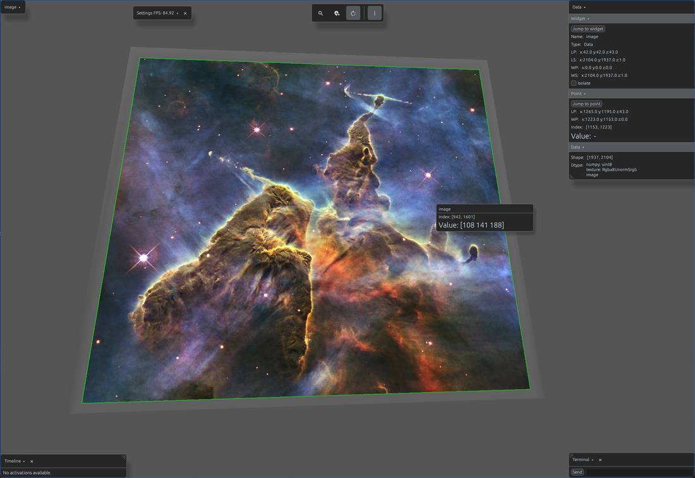

| Color map turbo | Zoom in to single pixel |
|---|---|
| 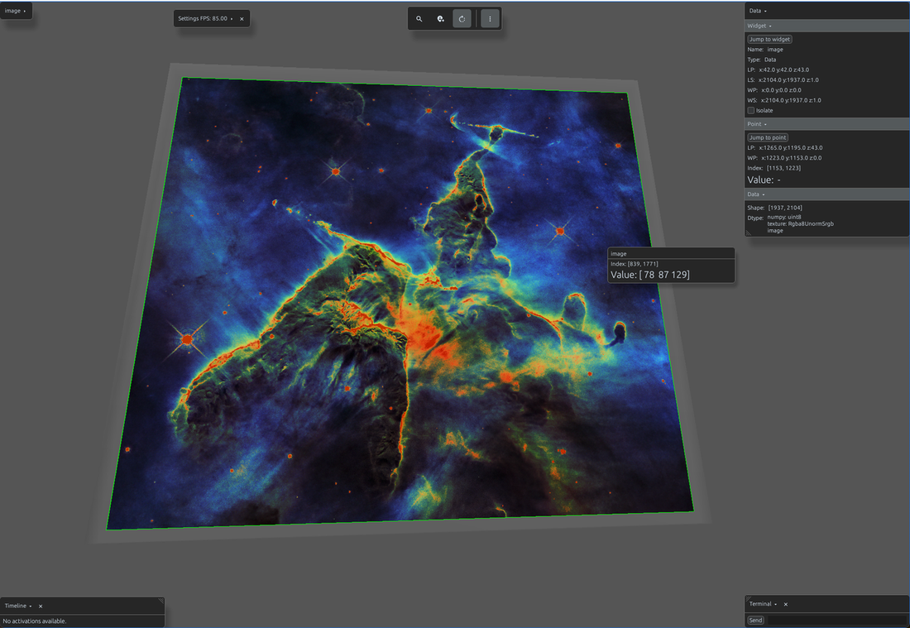 | 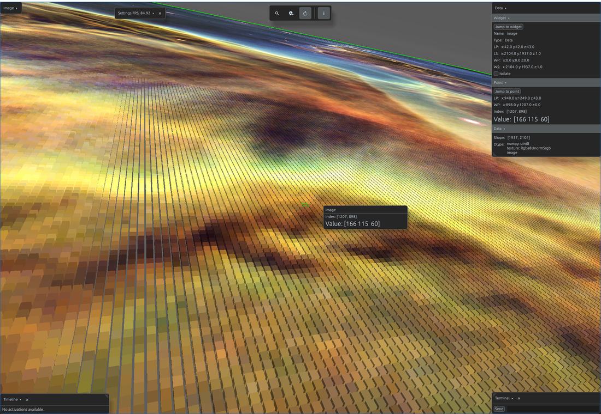 |

### Batch image inspection

For multiple images, `images` allows you to pass a list of mixed-source images. The engine tiles them in 3D space, enabling you to rotate and zoom through entire batches.

```python
import svetoviz_webgpu as sv

image1_url = "https://t4.ftcdn.net/jpg/02/70/3..."
image2_url = "https://www.mamp.one/wp-content/..."
image3_url = "https://img.freepik.com/free-photo/..."
filepath1 = "random_images/random_image_1.jpg"
filepath2 = "/datasets/nasaimages/heic1007a.tif"
filepath3 = "/datasets/nasaimages/heic2409b.tif"
filepath4 = "/datasets/nasaimages/heic2409a.tif"

sv.images(images=[
    image1_url, image2_url, image3_url,
    filepath1, filepath2, filepath3, filepath4
])
```

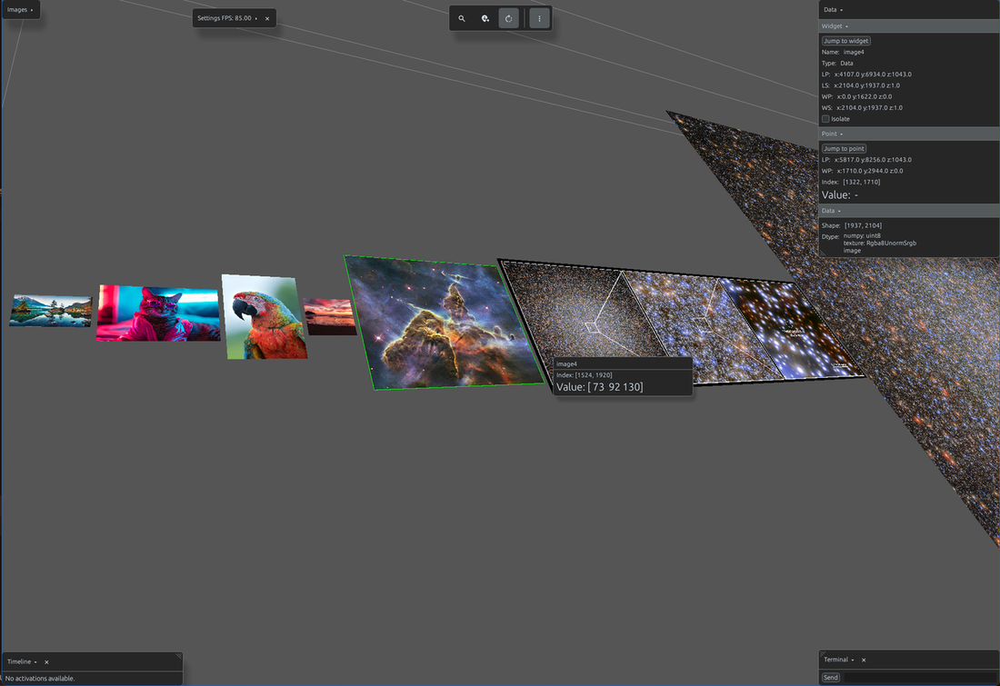

### Cache and performance

Images processed via `image` and `images` are loaded eagerly and streamed directly from disk to ensure low latency during inspection. You can explicitly define the storage location for cached assets by modifying the global configuration:

```python
# Set an environment variable for caching
import os
os.environ["SVETO_VIZ_CACHE_DIR"] = "/path/to/your/custom/cache"

import svetoviz_webgpu as sv

# Verify cache directory
current_cache = sv.get_cache_dir()
```

While these methods are optimized for rapid previews and medium-sized batches, they are not intended for massive datasets. For high-performance scenes containing hundreds of thousands of images, use the **Views API** for tile-based, lazy-loading spatial optimization.

---

## 5. NumPy

The core of Svetoviz is its ability to handle raw NumPy arrays of any dimension and data type. Whether you are inspecting a single tensor or a collection of disparate arrays, the engine provides 3D spatial awareness for every element.

### Single array inspection

Use `array` to project a single NumPy array into the 3D scene. The `gap_size` parameter controls the visual spacing between high-dimensional slices, making it easier to identify patterns across tensors.

```python
import svetoviz_webgpu as sv

data = np.random.rand(4, 4, 32, 32).astype(np.float32)

sv.array(data, gap_size=10)
```

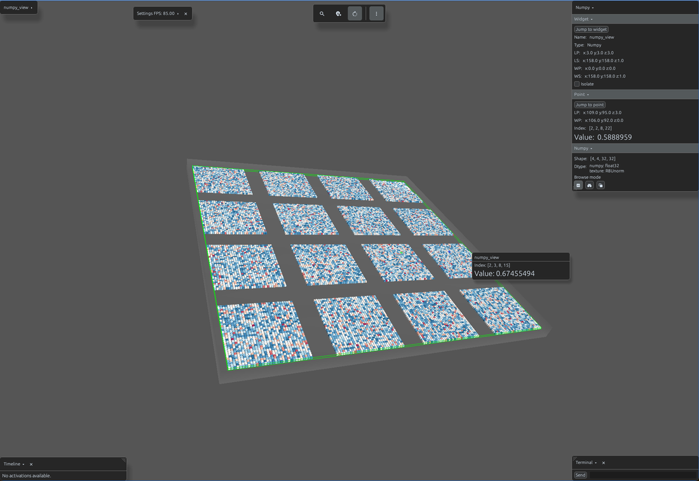

### Dimensional stacking and colormaps

Svetoviz handles high-dimensional tensors by "stacking" them along specific axes. This transforms multidimensional data into a physical 3D structure where numerical values are mapped to visual gradients in real time.

| Dimensional stacking | Colormap application |
|---|---|
| 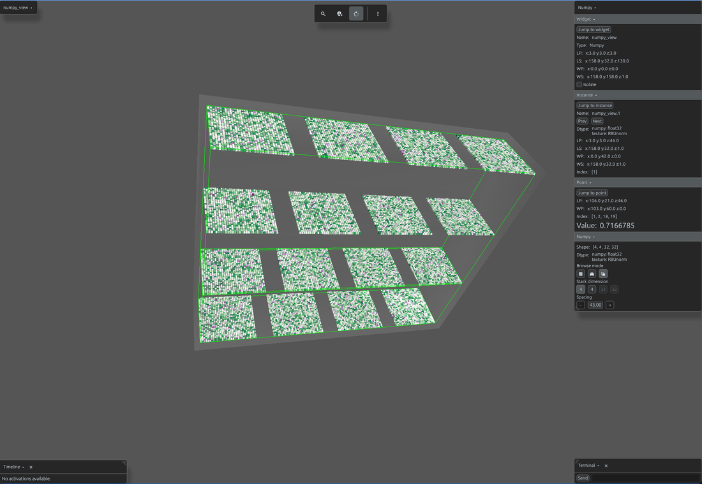 | 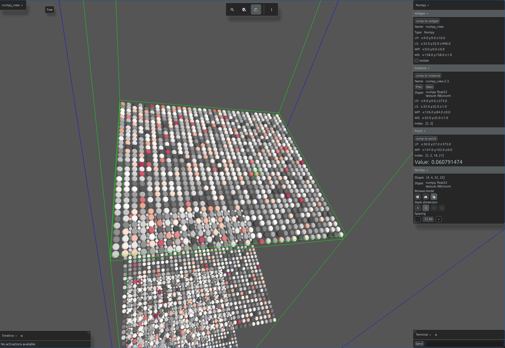 |

### Visualizing multiple data types

Svetoviz supports the full spectrum of NumPy dtypes - from standard integers and floats to complex numbers and booleans. Using `arrays`, you can pass a list of arrays with varying shapes and types.

```python
import svetoviz_webgpu as sv

sv.arrays([
    # integers
    np.random.randint(np.iinfo(np.int8).min, np.iinfo(np.int8).max, (2, 2, 128, 128), dtype=np.int8),
    np.random.randint(np.iinfo(np.int16).min, np.iinfo(np.int16).max, (2, 3, 128, 128), dtype=np.int16),
    np.random.randint(np.iinfo(np.int32).min, np.iinfo(np.int32).max, (4, 4, 64, 64), dtype=np.int32),
    np.random.randint(np.iinfo(np.int64).min, np.iinfo(np.int64).max, (4, 2, 32, 64), dtype=np.int64),
    np.random.randint(np.iinfo(np.uint8).min, np.iinfo(np.uint8).max, (2, 3, 128, 128), dtype=np.uint8),
    np.random.randint(np.iinfo(np.uint16).min, np.iinfo(np.uint16).max, (16, 128, 128), dtype=np.uint16),
    np.random.randint(np.iinfo(np.uint32).min, np.iinfo(np.uint32).max, (4, 4, 64, 64), dtype=np.uint32),
    np.random.randint(np.iinfo(np.uint64).min, np.iinfo(np.uint64).max, (4, 2, 32, 64), dtype=np.uint64),
    np.random.randint(np.iinfo(np.ubyte).min, np.iinfo(np.ubyte).max, (16, 16, 16), dtype=np.ubyte),
    np.random.randint(np.iinfo(np.byte).min, np.iinfo(np.byte).max, (8, 2, 24, 24), dtype=np.byte),
    np.random.randint(np.iinfo(np.intp).min, np.iinfo(np.intp).max, (64, 64), dtype=np.intp),
    np.random.randint(np.iinfo(np.uintp).min, np.iinfo(np.uintp).max, (64, 64), dtype=np.uintp),
    np.random.choice([True, False], (2, 72, 72)).astype(np.bool_),

    # floats
    (np.random.uniform(-1, 1, (256, 256)) * np.finfo(np.float16).max).astype(np.float16),
    (np.random.uniform(-1, 1, (32, 32, 32)) * np.finfo(np.float32).max).astype(np.float32),
    (np.random.uniform(-1, 1, (4, 3, 32, 32)) * np.finfo(np.float64).max).astype(np.float64),

    # complex numbers
    (np.random.randn(32, 32) + 1j * np.random.randn(32, 32)).astype(np.complex64),
    (np.random.randn(32, 32) + 1j * np.random.randn(32, 32)).astype(np.complex128),
], gap_size=32)
```

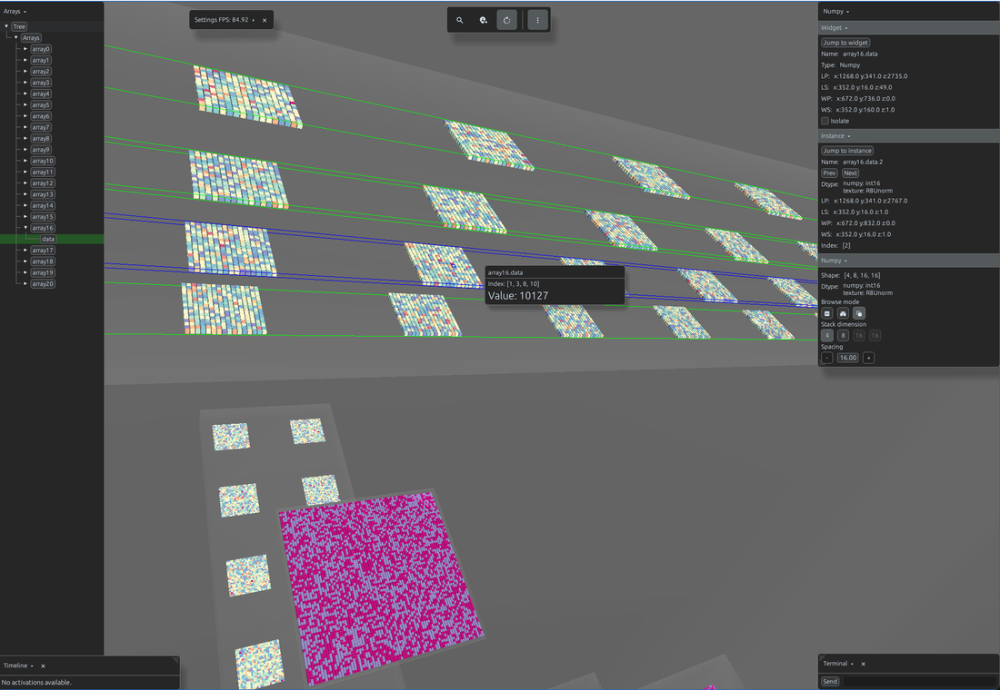

### Axis ordering for tensors

By default, Svetoviz expects the last two dimensions of an array to represent the spatial height and width `(H, W)`. When passing standard image data in `(H, W, C)` format, the engine renders the channels as the spatial grid, resulting in a distorted view.

```python
import svetoviz_webgpu as sv

# Standard PIL to NumPy conversion results in (H, W, C)
data = np.array(image)

# This will render incorrectly as it treats 'C' as part of the (H, W) pair
sv.array(data, gap_size=0)
```

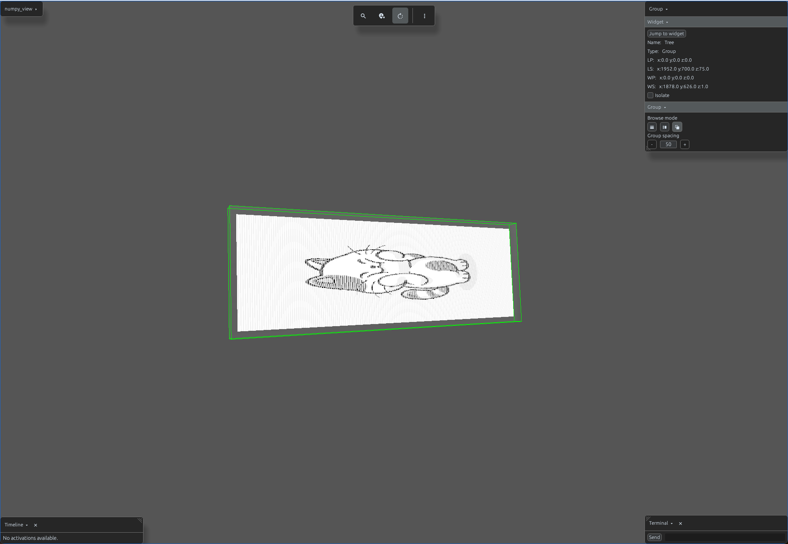

To resolve this, use the `ordering` parameter to transpose the axes for the 3D projection without modifying the original array in memory. For a standard `(H, W, C)` image, use `ordering=(2, 0, 1)` to correctly map the dimensions.

```python
import svetoviz_webgpu as sv

# Standard PIL to NumPy conversion results in (H, W, C)
data = np.array(image)

# Correctly map (H, W, C) to (C, H, W) for the 3D scene
sv.array(data, gap_size=0, ordering=(2, 0, 1))
```

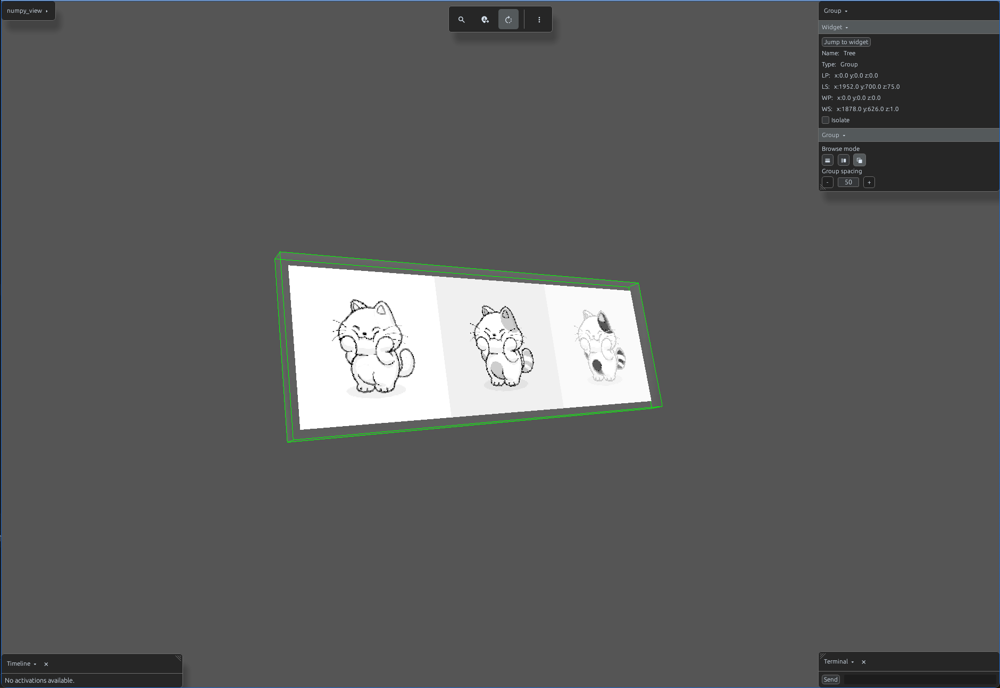

### High-dimensional large arrays

Svetoviz handles large arrays with ease. You can, for example, see all frames from a videoclip at once, allowing for a comprehensive spatial overview of temporal data.

```python
import svetoviz_webgpu as sv

# Load your video as a numpy array
array = video_to_5d_grid('bunny.mp4')
sv.array(array)
```

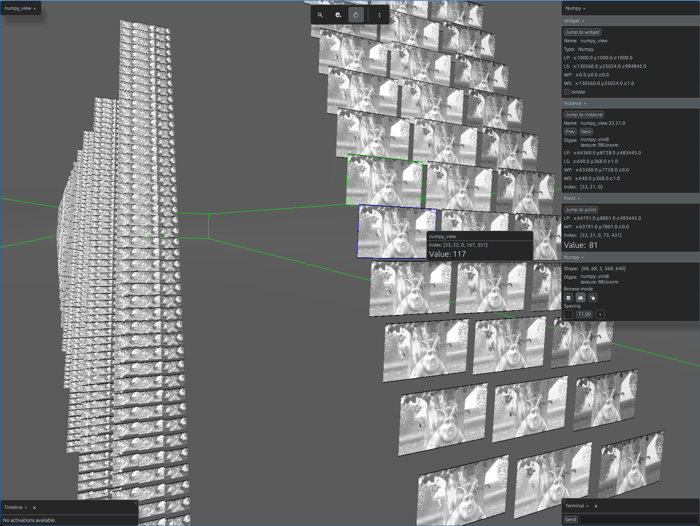

---

## 6. Datasets

Svetoviz provides integrated support for the Hugging Face `datasets` ecosystem. By utilizing the `DatasetView`, you can transform massive remote repositories into persistent, locally-browsable 3D environments with optimized image tiling.

### Building a dataset scene

```python
import svetoviz_webgpu as sv
from datasets import load_dataset

hf_name = "Dewa/Dog_Emotion_Dataset_v2"
dataset = load_dataset(hf_name, split="train")

layout = sv.DatasetView(
    id=hf_name,
    dataset=dataset,
    image_columns=["image"],
    info_columns=["emotion"],
    cell_width=400,
    cell_height=400
)

sv.save_to_disc(
    view=layout,
    compression="png_0",
    directory=output_directory
)
```

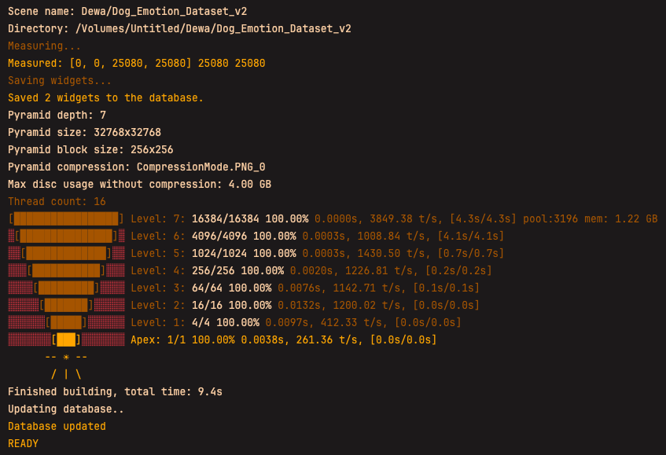

`DatasetView` parameters:

| Parameter | Meaning |
|---|---|
| `id` | Scene / dataset identifier shown in the viewer |
| `dataset` | A `datasets.Dataset` (or a `select()` subset of it) |
| `image_columns` | Columns holding images to tile into the grid |
| `info_columns` | Text columns indexed into the search database |
| `cell_width` / `cell_height` | Pixel size of each rendered entry |
| `image_backend` | Pillow or the alternative image backend |
| `info_column_mapping_func` | Maps raw ids to human labels |

### Starting the dataset

```python
import svetoviz_webgpu as sv

sv.load_from_disc(directory=output_directory)
```

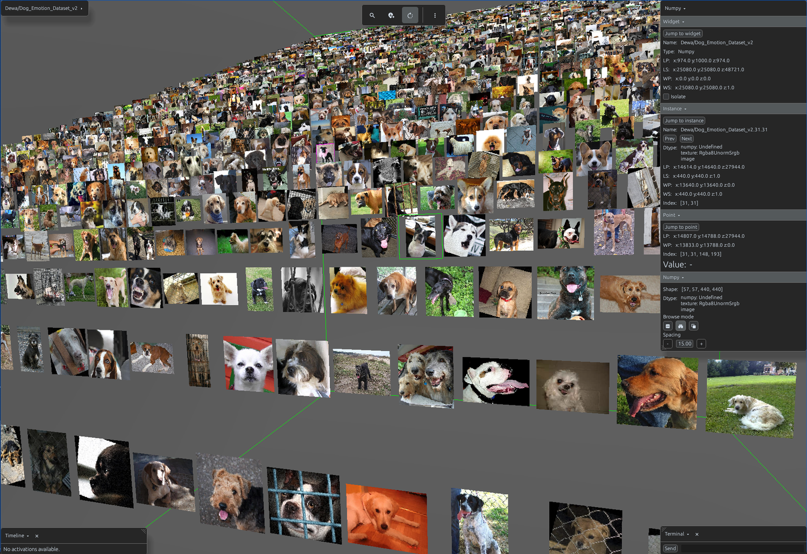

### Building the search database

Include `info_columns` to automatically build the search database:

```python
import svetoviz_webgpu as sv
from datasets import load_dataset

hf_name = "eltorio/ROCOv2-radiology"
dataset = load_dataset(hf_name, split="train")

layout = sv.DatasetView(
    id=hf_name,
    dataset=dataset,
    image_columns=["image"],
    info_columns=["image_id", "caption", "cui"],
    cell_width=400,
    cell_height=400
)

sv.save_to_disc(
    view=layout,
    compression="png_0",
    directory=output_directory
)
sv.load_from_disc(directory=output_directory)
```

Use the web interface to search over the entire dataset:

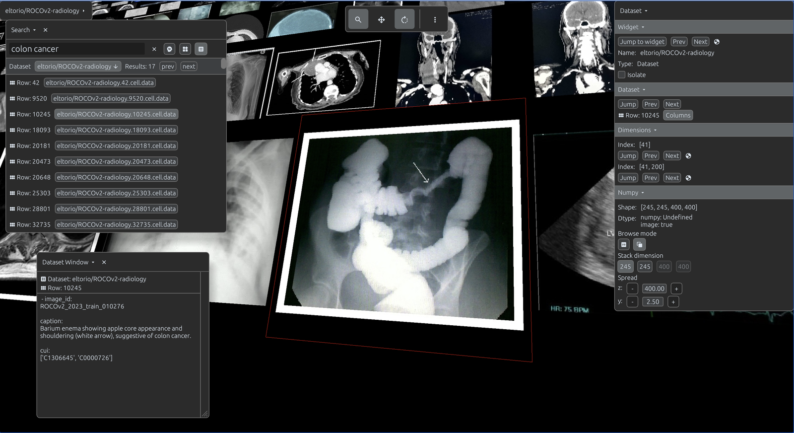

You can also explore datasets already published online at https://app.svetoviz.com.

### Compression and performance

The selected compression type dictates the following parameters of the final scene:

- **Quality of the final scene**
- **Total disk usage of the final scene**
- **Total build time of the scene**

**PNG compression levels**

| Available constants |
|---|
| `PNG_0` (Highest Quality) |
| `PNG_1` |
| `PNG_2` |
| `PNG_3` |
| `PNG_4` |
| `PNG_5` |
| `PNG_6` |
| `PNG_7` |
| `PNG_8` |
| `PNG_9` (Lowest Quality) |

**JPEG compression levels**

| Available constants |
|---|
| `JPEG_0` (Highest Quality) |
| `JPEG_1` |
| `JPEG_2` |
| `JPEG_3` |
| `JPEG_4` |
| `JPEG_5` |
| `JPEG_6` |
| `JPEG_7` |
| `JPEG_8` |
| `JPEG_9` (Lowest Quality) |

---

## 7. Views and Layouts

The Views API provides a declarative way to organize multiple data sources into a single 3D scene. By using Layout containers, you can create structured environments for comparative analysis and large-scale dataset inspection.

### Views and layouts

The Views API is built on two primary class types: `View` and `Layout`.

- **Views** represent individual data points, encapsulating various formats such as NumPy arrays, images, or other specialized data structures.
- **Layouts** organize collections of views into structured 3D scenes by defining spatial relationships, such as line arrangements or grids. Layouts are inherently composable, allowing you to nest them within one another to build complex, multi-tiered visual environments.

### NumpyView

```python
import svetoviz_webgpu as sv

view = sv.NumpyView(
        id="numpy_view_example",
        data=np.random.rand(4, 4, 32, 32).astype(np.float32),
        gap_size=10)

sv.view(view=view)
```

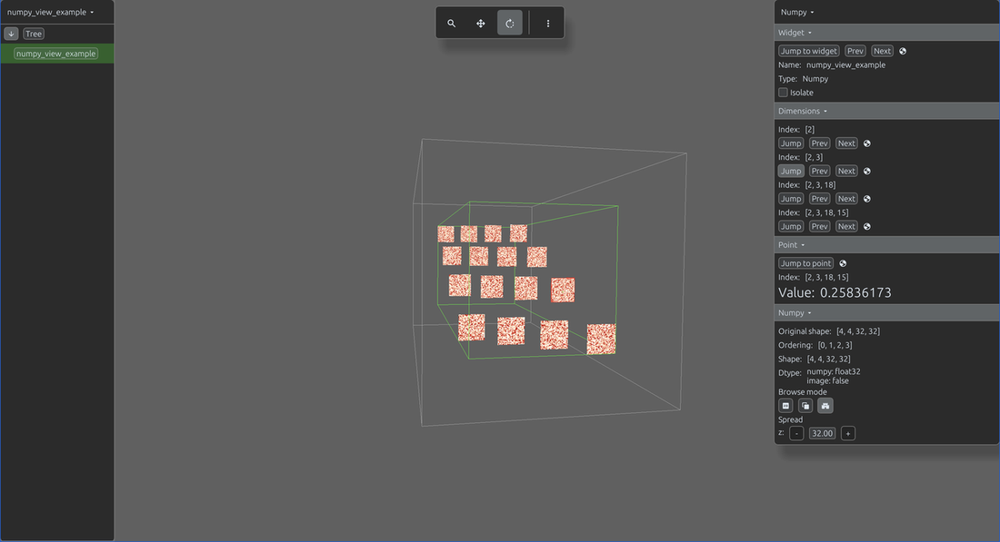

```python
import svetoviz_webgpu as sv

image = Image.open(BytesIO(requests.get(IMAGE_URL).content))
data = np.array(image)
view = sv.NumpyView(
        id="numpy_image_channels",
        data=data,
        gap_size=10,
        ordering=(2, 0, 1))

sv.view(view=view)
```

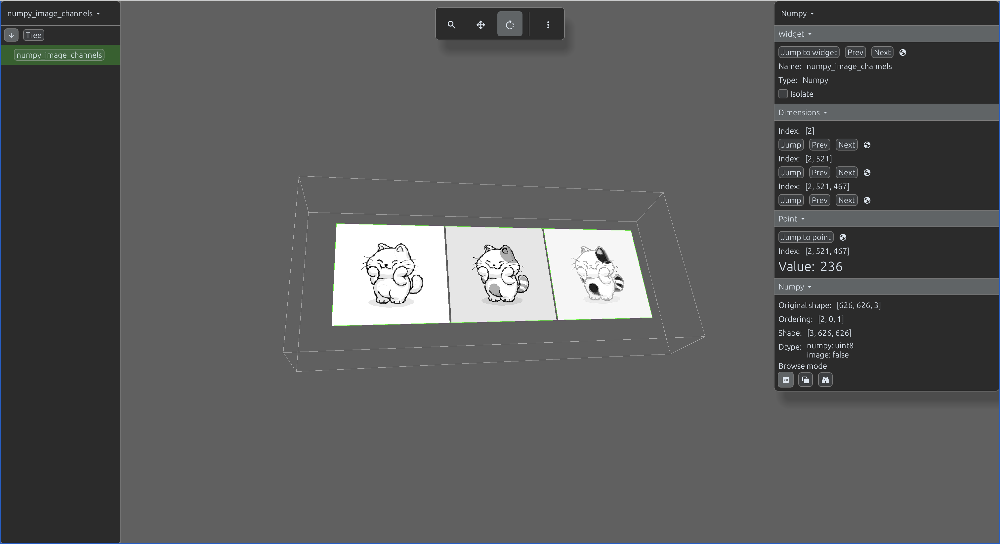

| Raw array projection | Transposed mapping |
|---|---|
| 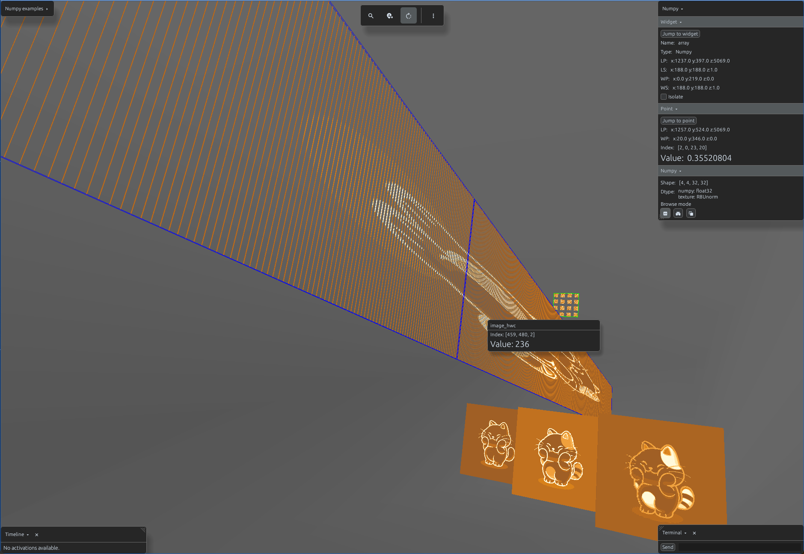 | 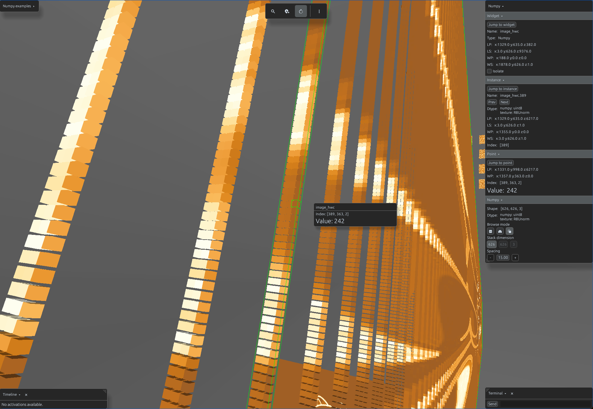 |

### ImageView

For images, use `DiscImageView` to stream assets directly from storage, or `LazyImageView` to lazy-load images into RAM only when required. Both classes accept a URL, a local file path, or a PIL image object as the source.

```python
import svetoviz_webgpu as sv

view = sv.DiscImageView(
        id="disc_image",
        image=IMAGE_URL)

# or

view = sv.LazyImageView(
        id="lazy_image",
        image=IMAGE_URL)

sv.view(view=view)
```

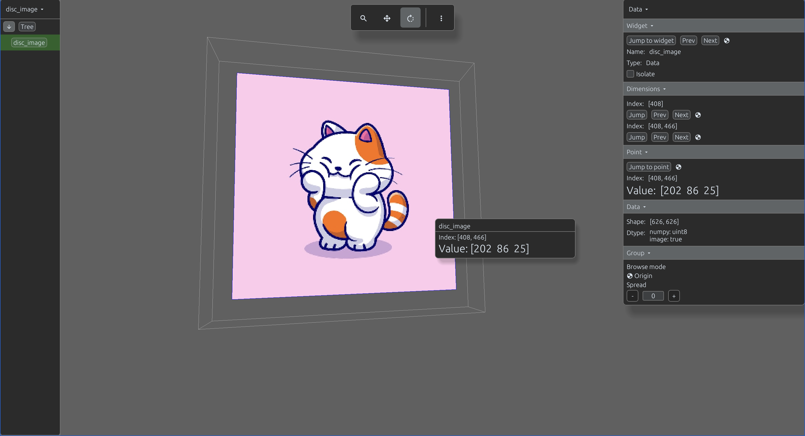

### DirectoryGridView

The `DirectoryGridView` is a specialized layout class designed to automatically load and organize an entire directory of images into a structured grid scene.

```python
import svetoviz_webgpu as sv

# Optional function to provide searchable description per filepath
def description_func(filepath):
    return f"My description for {filepath}"

layout = sv.DirectoryGridView(
    id="directory_grid_example",
    directory=directory,
    limit=100,
    lazy=False,
    description_func=description_func
)

sv.view(layout)
```

| Grid overview | Grid spread |
|---|---|
| 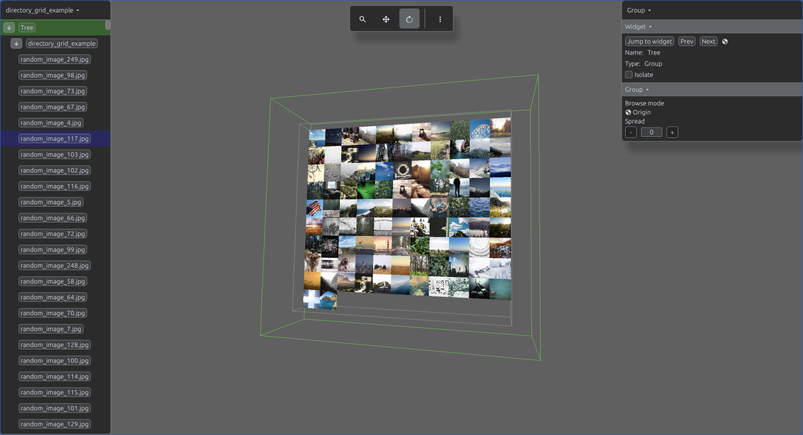 | 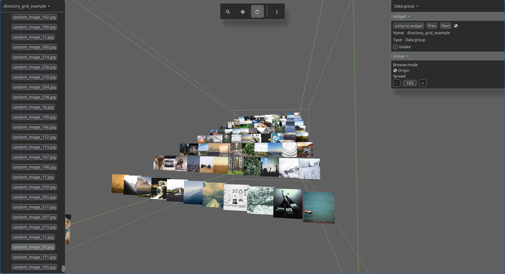 |

### DirectorySpiralView

The `DirectorySpiralView` is a specialized layout class designed to automatically load and organize an entire directory of images into a structured spiral scene.

```python
import svetoviz_webgpu as sv

# Optional function to provide searchable description per filepath
def description_func(filepath):
    return f"My description for {filepath}"

layout = sv.DirectorySpiralView(
    id="directory_spiral_view",
    directory=directory,
    limit=100,
    lazy=False,
    description_func=description_func
)

sv.view(layout)
```

| Spiral overview | Spiral spread |
|---|---|
| 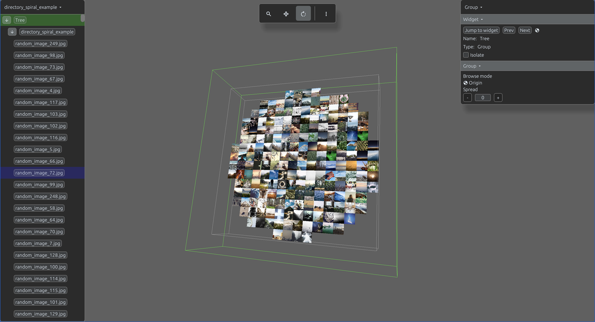 | 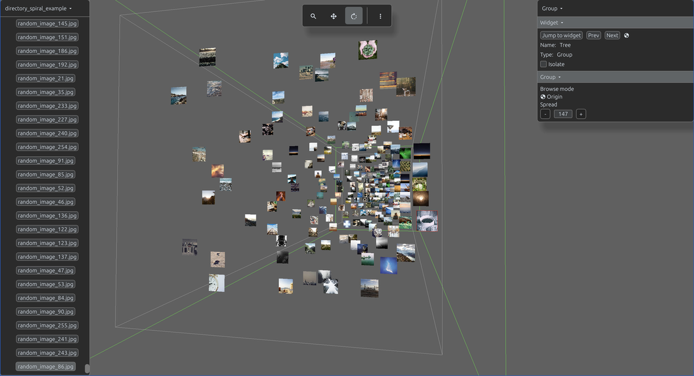 |

**Lazy vs eager loading**

- `lazy=True` is limited by available RAM, and the scene may appear empty at launch until data loads.
- `lazy=False` is limited by available disc space for the `DiscImageView` memory files and by the maximum number of open file descriptors.
- `sv.view()` may start failing around 500 - 1000 data points. For larger collections, build the scene offline (see [Offline scene building](#offline-scene-building)).

### DatasetView

The `DatasetView` enables the integration of Hugging Face datasets directly into your scene. It automatically processes a dataset object and renders its entries into a structured grid of images. You will learn more about `DatasetView` in [Datasets](#6-datasets).

```python
import svetoviz_webgpu as sv

hf_name = "Dewa/Dog_Emotion_Dataset_v2"
dataset = load_dataset(hf_name, split="train")
subset = dataset.select(range(100))

layout = sv.DatasetView(
    id=hf_name,
    dataset=subset,
    info_columns=["emotion"],
    image_columns=["image"],
    cell_width=400,
    cell_height=400
)

sv.view(layout)
```

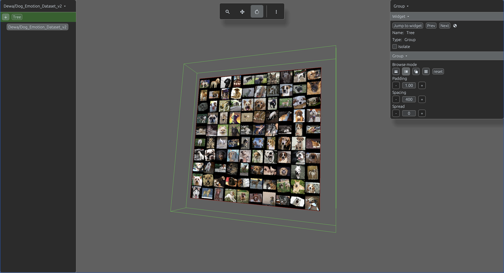

### VerticalLayout

The `VerticalLayout` arranges its child views in a linear vertical stack.

```python
import svetoviz_webgpu as sv
numpy_array = np.random.rand(4, 4, 32, 32).astype(np.float32)
image = Image.open(BytesIO(requests.get(IMAGE_URL).content))
image_array = np.array(image)

layout = sv.VerticalLayout(
    id="vertical_layout_example",
    views=[
        sv.NumpyView(
            id="array",
            data=numpy_array,
            gap_size=10,
            ordering=None),
        sv.NumpyView(
            id="image_array",
            data=image_array,
            gap_size=10,
            ordering=(2, 0, 1)),
        sv.DiscImageView(
            id="disc_image",
            image=image),
        sv.LazyImageView(
            id="lazy_image",
            image=image)
        ],
    )

sv.view(layout)
```

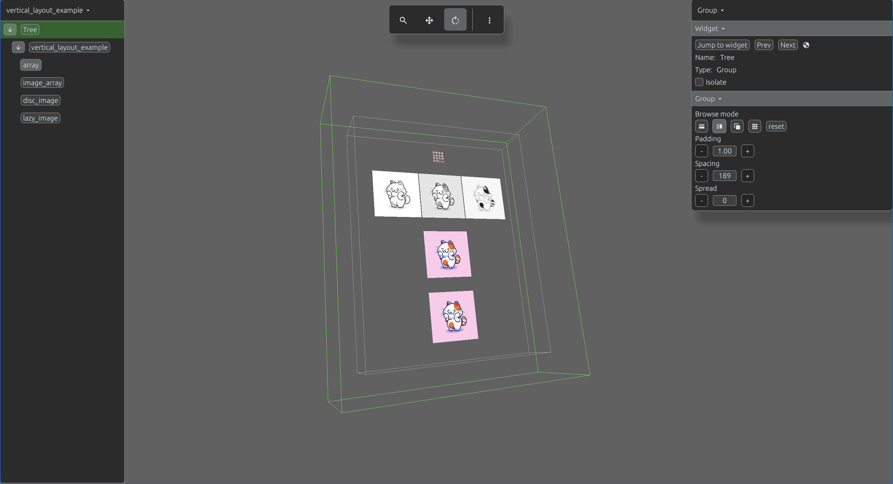

### HorizontalLayout

The `HorizontalLayout` arranges its child views in a linear horizontal stack.

```python
import svetoviz_webgpu as sv

numpy_array = np.random.rand(4, 4, 32, 32).astype(np.float32)
image = Image.open(BytesIO(requests.get(IMAGE_URL).content))
image_array = np.array(image)

layout = sv.HorizontalLayout(
    id="layout",
    title="Horizontal layout",
    views=[
        sv.NumpyView(
            id="array",
            data=numpy_array,
            gap_size=10),
        sv.NumpyView(
            id="image_array",
            data=image_array,
            gap_size=10,
            ordering=(2, 0, 1)),
        sv.DiscImageView(
            id="disc_image",
            image=image),
        sv.LazyImageView(
            id="lazy_image",
            image=image)
    ],
)

sv.view(layout)
```

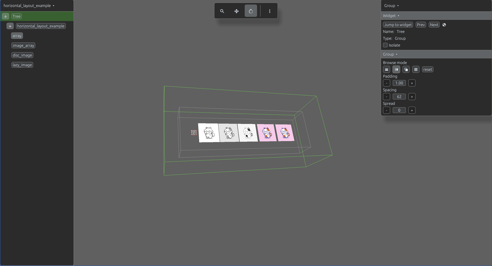

### GridLayout

The `GridLayout` arranges its child views in a grid.

```python
import svetoviz_webgpu as sv

directory = "downloaded_images"
image_sources = []
for root, dirs, files in os.walk(directory):
    for file in files:
        image_sources.append(os.path.join(root, file))

image_views = [
    sv.DiscImageView(id=f"img_{i}", image=src)
    # or sv.LazyImageView(id=f"img_{i}", image=src)
    for i, src in enumerate(image_sources)
]

grid = sv.GridLayout(id="grid_layout_example", views=image_views)
sv.view(grid)
```

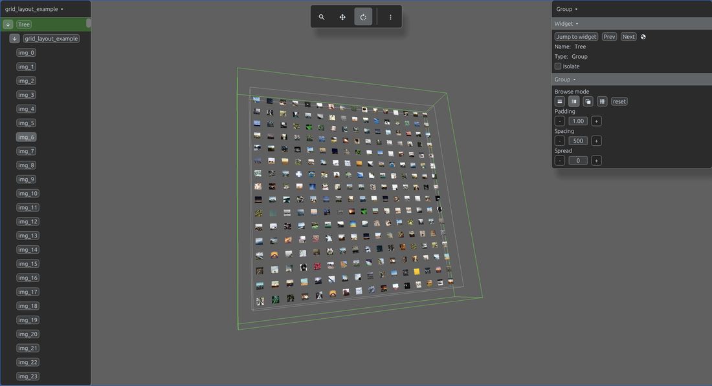

### Nesting layouts

Layouts can be nested to create complex, multi-tiered scenes. Each layout object accepts an optional `title` argument; when provided, the title is rendered as an additional child at the beginning of the collection, adhering to the parent's defined spatial positioning.

```python
import svetoviz_webgpu as sv

disc_image = sv.DiscImageView(
    id="disc_image",
    image="sample_image.jpg")

lazy_image = sv.LazyImageView(
    id="lazy_image",
    image="sample_image.jpg")

array = sv.NumpyView(
    id="array",
    data=np.random.rand(4, 32, 4, 245, 245).astype(np.float32),
    gap_size=10)

images_directory = "downloaded_images"

dir_spiral_view = sv.DirectorySpiralView(
    id="dir_spiral",
    directory=images_directory,
    limit=100,
    lazy=False
)
dir_grid_view = sv.DirectoryGridView(
    id="dir_grid",
    directory=images_directory,
    limit=100,
    lazy=False
)

hf_name = "Dewa/Dog_Emotion_Dataset_v2"
dataset = load_dataset(hf_name, split="train")
subset = dataset.select(range(500))
subset2 = dataset.select(range(500, 1000))

subset_view_1 = sv.DatasetView(
    id="subset1",
    dataset=subset,
    image_columns=["image"],
    info_columns=["emotion"],
    cell_width=400,
    cell_height=400
)
subset_view_2 = sv.DatasetView(
    id="subset2",
    dataset=subset2,
    image_columns=["image"],
    info_columns=["emotion"],
    cell_width=400,
    cell_height=400
)

array_container = sv.VerticalLayout(
    id="Numpy",
    title="Numpy",
    views=[array])
image_container = sv.VerticalLayout(
    id="Image",
    title="Images",
    views=[disc_image, lazy_image])
directory_grid_container = sv.VerticalLayout(
    id="directory_grid_id",
    title="Directory grid view",
    views=[dir_grid_view])
directory_spiral_container = sv.VerticalLayout(
    id="directory_spiral_id",
    title="Directory spiral view",
    views=[dir_spiral_view])
subset_1_container = sv.VerticalLayout(
    id="dataset_subset_1",
    title="Subset 1",
    views=[subset_view_1])
subset_2_container = sv.VerticalLayout(
    id="dataset_subset_2",
    title="Subset 2",
    views=[subset_view_2])

layout = sv.GridLayout(
        id="parent_layout",
        views=[
            image_container,
            array_container,
            directory_grid_container,
            directory_spiral_container,
            subset_1_container,
            subset_2_container]
    )

sv.view(layout)
```

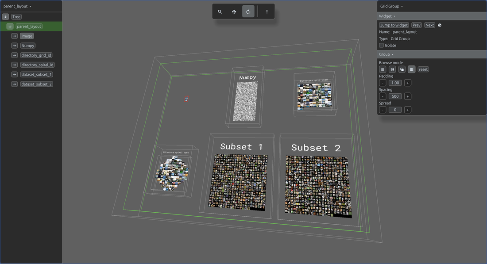

You can switch between different layout types at any time directly through the web interface. Additionally, you can dynamically modify properties such as spacing, padding, and spread to refine the spatial organization of your scene.

| Horizontal spread | Vertical spread |
|---|---|
| 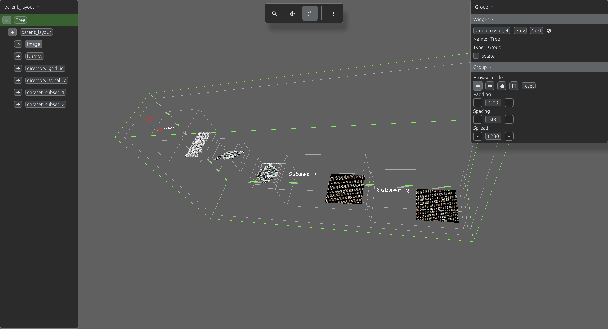 | 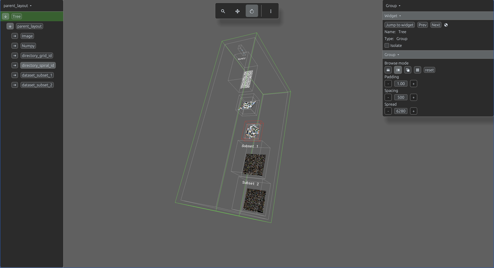 |

### Offline scene building

<a id="offline-scene-building"></a>

Displaying a scene with `view` is typically sufficient for scenes containing a small number of data points. For large-scale scenes, build your scene offline. Once the scene is built, you can launch it directly from the directory without requiring access to the original source data.

This example demonstrates building a unified scene from the complete **ESA/Hubble** and **ESA/Webb** image catalogs in maximum quality.

```python
import svetoviz_webgpu as sv

images_directory = "/Users/piotrgryko/Desktop/nasaimages"
config_file_path = os.path.join(images_directory, "config.json")

scraped_data = {}
with open(config_file_path, "r", encoding="utf-8") as f:
    scraped_data = json.load(f)

def description_func(filepath):
    filename = os.path.basename(filepath)
    name_without_ext = os.path.splitext(filename)[0]
    metadata = scraped_data.get(name_without_ext, {})
    lines = []
    for key, value in metadata.items():
        lines.append(f"{key}: {value}")
    return "\n\n".join(lines)

layout = sv.DirectorySpiralView(
    id="Galaxy",
    directory=images_directory,
    lazy=True,
    description_func=description_func
)

# Export to persistent storage
sv.save_to_disc(
    view=layout,
    threaded=True,
    directory="output/space_scene",
    compression="jpeg_0"
)
```

Once the build is complete, launch the interactive 3D environment directly from the directory:

```python
import svetoviz_webgpu as sv

sv.load_from_disc(directory="output/space_scene")
```

Alternatively, you can process the scene further and generate a PMTiles file for remote hosting and streaming:

```python
import svetoviz_webgpu as sv

# Create PMTiles file inside the scene directory
sv.build_pmtiles_file(
    directory="output/space_scene"
)
```

After uploading the generated PMTiles file to a remote server, you can browse the scene from anywhere without distributing the original dataset:

```python
import svetoviz_webgpu as sv

db_file = "output/space_scene/tree.db"
url = "your remote pmtiles file url"

layout = sv.RemotePmTilesLayout(
    id="universe",
    pm_tiles_url=url,
    tree_db_file=db_file
)

sv.view(layout)
```

To re-open a saved scene as a widget instead of launching it, use `DiskSceneView`:

```python
import svetoviz_webgpu as sv

# Saved Dog_Emotion_Dataset_v2 dataset
view = sv.DiskSceneView(
    id="dog_emotions",
    directory="output/dog_emotion_dataset"
)

# Saved ROCOv2-radiology dataset
view2 = sv.DiskSceneView(
    id="roco_radiology",
    directory="output/roco_scene"
)

layout = sv.VerticalLayout(id="scenes", views=[view, view2])
sv.view(layout)
```

---

## 8. torch.Tensor

Svetoviz supports `torch.Tensor` visualization exactly like standard NumPy arrays.

### Single torch.Tensor inspection

Use `tensor()` to project a single `torch.Tensor` into the 3D scene. The `gap_size` parameter controls the visual spacing between high-dimensional slices.

```python
import svetoviz_webgpu as sv

data = torch.rand((4, 4, 256, 256), dtype=torch.float32)
sv.tensor(data, gap_size=10)
```

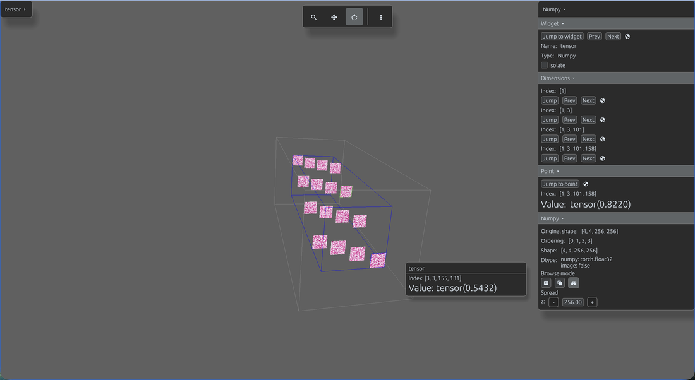

### Visualizing multiple tensor dtypes

Svetoviz supports the full spectrum of torch dtypes - from standard integers and floats to complex numbers and booleans. Using `tensors()`, you can pass a list of `torch.Tensor` with varying shapes and types.

```python
import svetoviz_webgpu as sv

sv.tensors([
    # integers
    torch.randint(0, 2, (2, 72, 72), dtype=torch.bool),
    torch.randint(np.iinfo(np.int8).min, np.iinfo(np.int8).max, (2, 60, 60), dtype=torch.int8),
    torch.randint(np.iinfo(np.int16).min, np.iinfo(np.int16).max, (4, 8, 16, 16), dtype=torch.int16),
    torch.randint(np.iinfo(np.int32).min, np.iinfo(np.int32).max, (4, 4, 64, 64), dtype=torch.int32),
    torch.randint(np.iinfo(np.int64).min, np.iinfo(np.int64).max, (4, 2, 32, 64), dtype=torch.int64),
    torch.randint(np.iinfo(np.uint8).min, np.iinfo(np.uint8).max, (2, 3, 128, 128), dtype=torch.uint8),
    torch.randint(np.iinfo(np.uint16).min, np.iinfo(np.uint16).max, (16, 128, 128), dtype=torch.uint16),
    torch.randint(np.iinfo(np.uint32).min, np.iinfo(np.uint32).max, (4, 4, 64, 64), dtype=torch.uint32),
    torch.frombuffer(np.random.bytes(4 * 2 * 32 * 64 * 8), dtype=torch.uint64).reshape(4, 2, 32, 64),

    # floats
    (torch.rand(256, 256, dtype=torch.float32) * torch.finfo(torch.float16).max).to(torch.float16),
    (torch.rand(256, 256, dtype=torch.float32) * torch.finfo(torch.bfloat16).max).to(torch.bfloat16),
    (torch.rand(256, 256, dtype=torch.float32) * torch.finfo(torch.float32).max).to(torch.float32),
    (torch.rand(256, 256, dtype=torch.float64) * torch.finfo(torch.float64).max).to(torch.float64),

    # complex numbers
    torch.complex(
        torch.rand(32, 32),
        torch.rand(32, 32)).to(torch.complex32) * torch.finfo(torch.complex32).max,
    torch.complex(
        torch.rand(32, 32),
        torch.rand(32, 32)).to(torch.complex64) * torch.finfo(torch.complex64).max,
    torch.complex(
        torch.rand(32, 32),
        torch.rand(32, 32)).to(torch.complex128) * torch.finfo(torch.complex128).max
], gap_size=32)
```

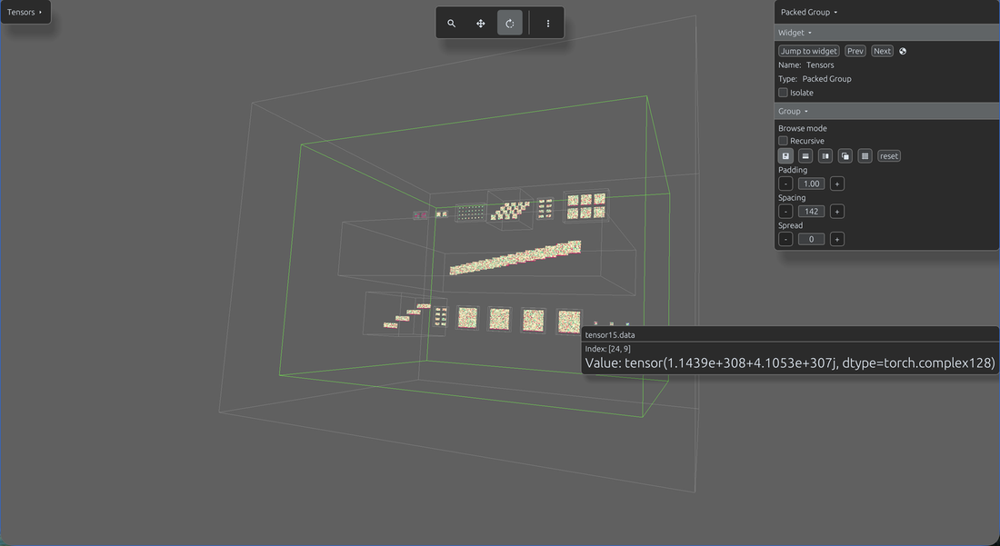

### Axis ordering and spatial mapping

`torch.Tensor` visualization inherits all features from standard NumPy views, including stacking, ordering, colormaps, and large tensor support. `TensorView` is also the primary view used for rendering PyTorch models.

```python
import svetoviz_webgpu as sv

view = sv.TensorView(
        id="tensor_view_example",
        data=torch.rand((4, 4, 256, 256), dtype=torch.float32),
        gap_size=10)

sv.view(view=view)
```

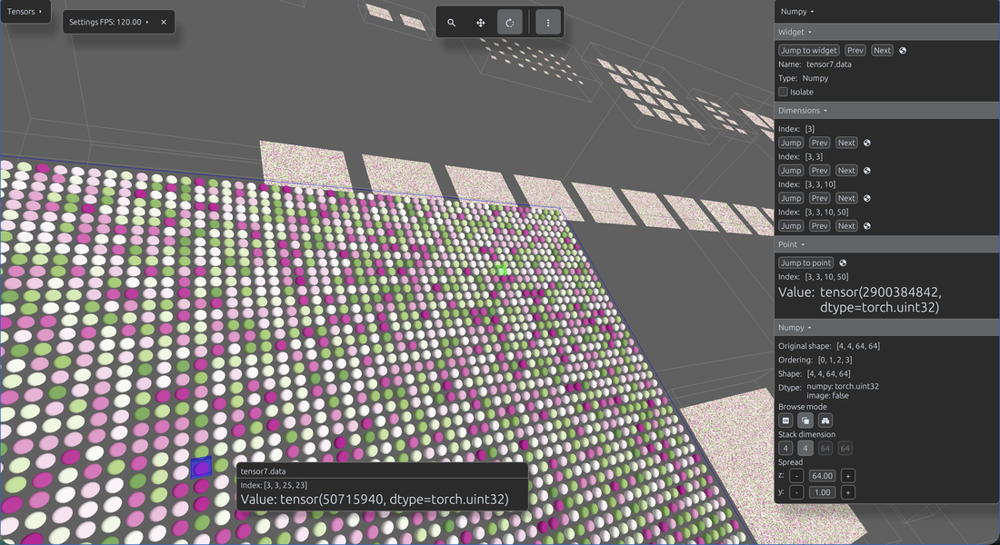

---

## 9. Models

Svetoviz provides two primary methods for attaching the debugger to your models.

```python
@classmethod
def model(cls,
    id,
    model,
    tokenizer=None,
    image_processor=None,
    video_processor=None,
    processor=None,
    scheduler=None,
    feature_extractor=None,
    terminal_callback=None,
    blocking=True
)
```

```python
@classmethod
def pipeline(cls,
    id,
    pipe,
    terminal_callback=None,
    blocking=True
)
```

To interact with the model, use the `terminal_callback` function to send data directly from the GUI, or use the `blocking=False` argument (WebGPU only) to attach the debugger in non-blocking mode and continue your standard interaction loop.

Selected breakpoints flash during interaction, and their activations are automatically collected. Afterward, you can visually inspect the input and output data alongside their relation to the module.

### GPT-2 terminal callback

```python
import svetoviz_webgpu as sv

tokenizer = GPT2Tokenizer.from_pretrained('gpt2', device_map="cpu")
model = GPT2LMHeadModel.from_pretrained('gpt2', device_map="cpu")

def terminal_callback(buffer, message, images, files):
    # message, images and files come from GUI terminal input
    inputs = tokenizer(message, return_tensors="pt")

    # Generate continuation
    outputs = model.generate(**inputs, max_new_tokens=50)

    # Decode to string
    decoded = tokenizer.decode(outputs[0], skip_special_tokens=True)

    # Send messages back to GUI
    buffer.send_user_message(message)
    buffer.send_system_message(decoded)

sv.model(
    id="GPT2",
    model=model,
    tokenizer=tokenizer,
    terminal_callback=terminal_callback
)
```

| GPT-2 architecture | GPT tokenizer |
|---|---|
| 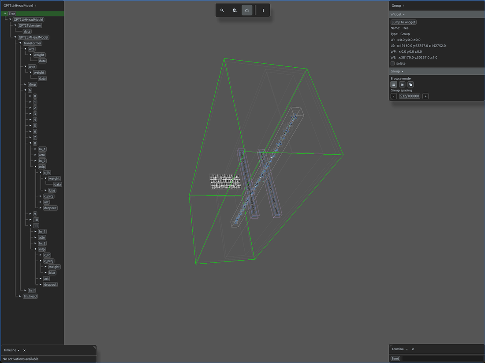 | 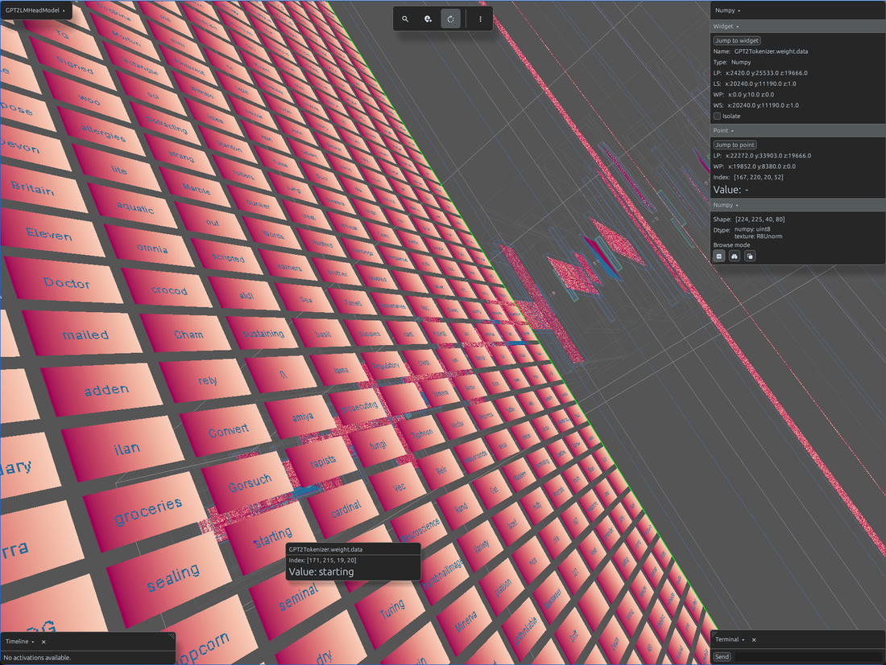 |

### DETR terminal callback

```python
import svetoviz_webgpu as sv

image_processor = DetrImageProcessor.from_pretrained(
    "facebook/detr-resnet-50",
    revision="no_timm",
    device_map="cpu")
model = DetrForObjectDetection.from_pretrained(
    "facebook/detr-resnet-50",
    revision="no_timm",
    device_map="cpu")

def terminal_callback(buffer, message, images, files):
    # images is an PIL.Image array of images added to terminal GUI
    for image in images:
        inputs = image_processor(images=image, return_tensors="pt")
        outputs = model(**inputs)
        buffer.send_system_message("processed")

sv.model(
    id="DERT",
    model=model,
    image_processor=image_processor,
    terminal_callback=terminal_callback
)
```

| DETR Conv2d | DETR kernel |
|---|---|
| 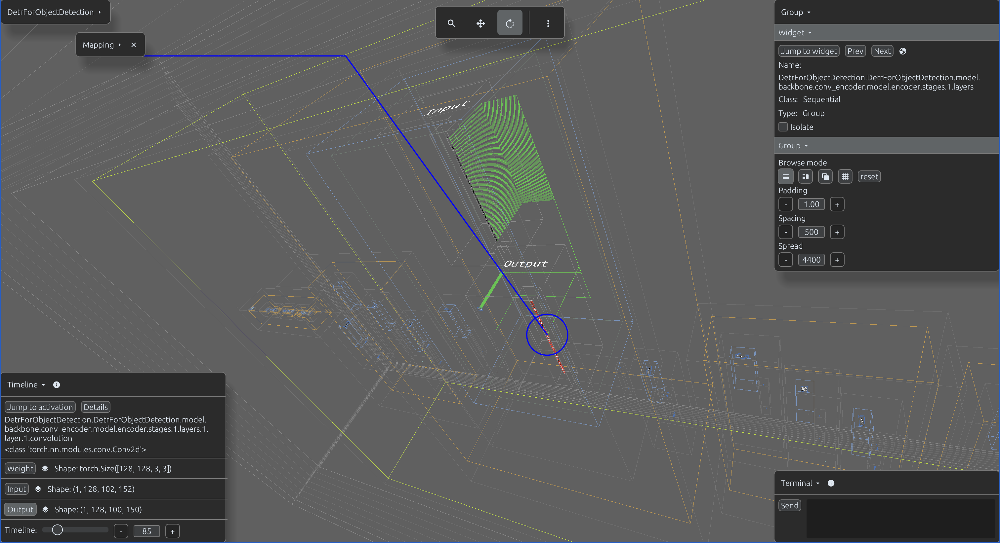 | 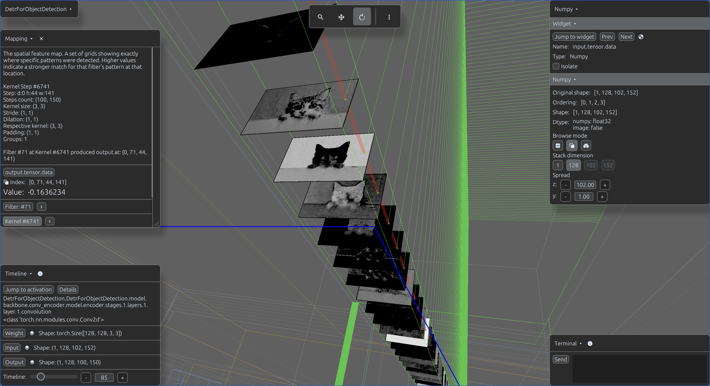 |

| YOLOS Conv2d | YOLOS linear |
|---|---|
| 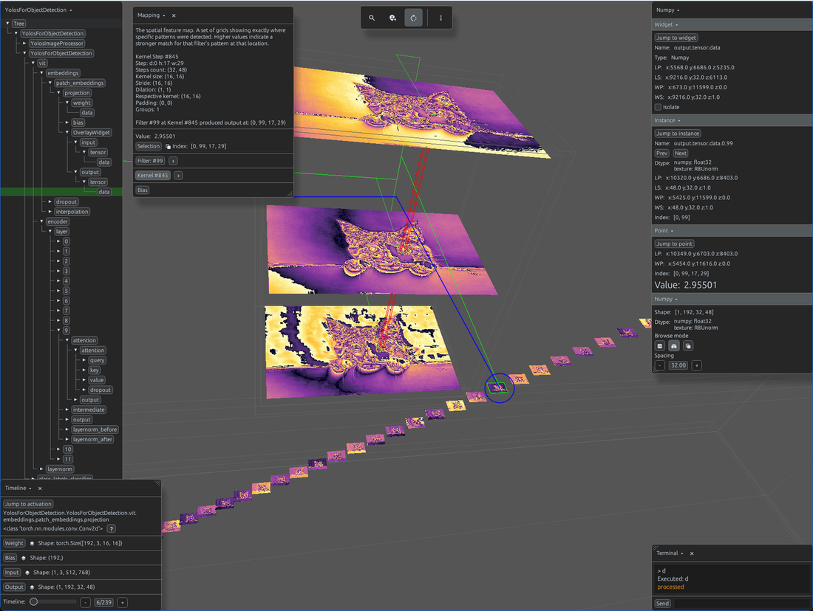 | 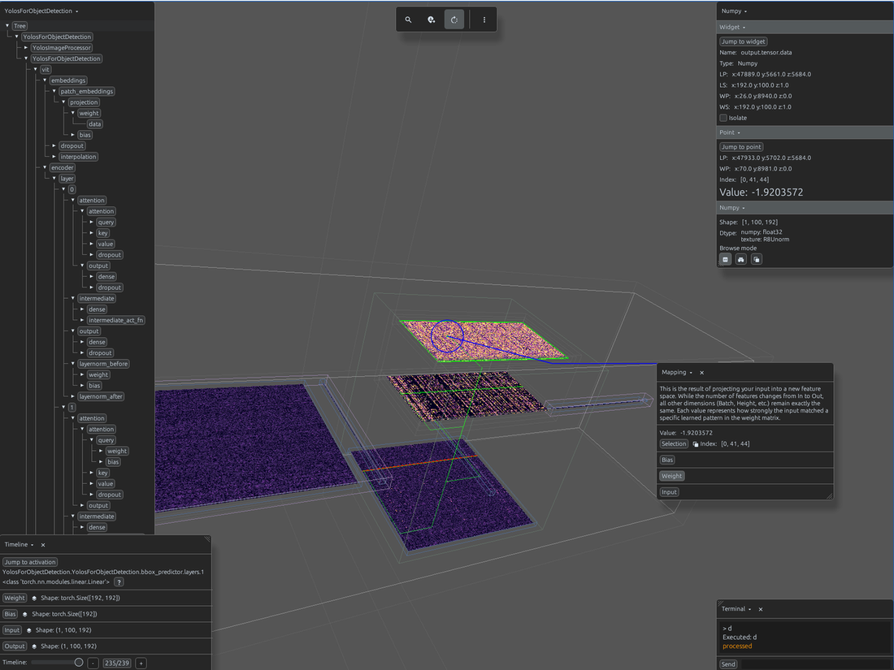 |

### Non-blocking mode

The `blocking=False` argument starts the debugger in non-blocking mode, allowing you to continue with your model interaction as usual.

```python
import svetoviz_webgpu as sv

tokenizer = AutoTokenizer.from_pretrained(
    "speakleash/Bielik-Minitron-7B-v3.0-Instruct")
model = AutoModelForCausalLM.from_pretrained(
    "speakleash/Bielik-Minitron-7B-v3.0-Instruct",
    torch_dtype=torch.float16)

sv.model(
    id="Bielik-Minitron-7B",
    model=model,
    tokenizer=tokenizer,
    blocking=False
)

while True:
    # Debugger is attached. You can interact or inspect training loop
    text = my_external_input_message()

    inputs = tokenizer(text, return_tensors="pt")
    outputs = model.generate(**inputs, max_new_tokens=50)
```

### Diffusion pipeline

Collected activations are stored in RAM. For small models, you can inspect an entire pass. For larger models like diffusion models, select specific breakpoints. For example, you can select the Scheduler module to see each step of the denoising process.

```python
import svetoviz_webgpu as sv

pipe = DiffusionPipeline.from_pretrained(
    "stable-diffusion-v1-5/stable-diffusion-v1-5",
    torch_dtype=torch.float16)

pipe = pipe.to("mps")
pipe.enable_attention_slicing()

def terminal_callback(buffer, message, images, files):
    # Generate an image from terminal input message
    buffer.send_system_message(message)
    image = pipe(message).images[0]
    image.show("output.png")

sv.pipeline(
    id="stable-diffusion-v1-5",
    pipe=pipe,
    terminal_callback=terminal_callback
)
```

| stable-diffusion-1-5 structure | stable-diffusion-1-5 activation |
|---|---|
| 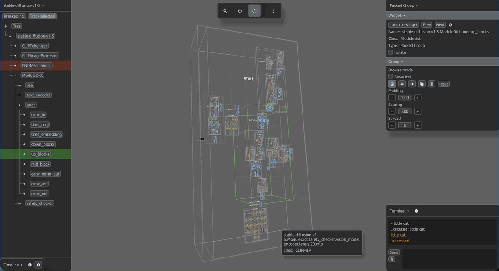 | 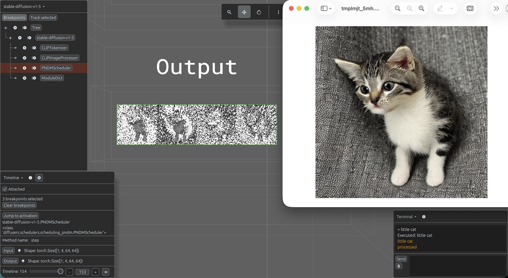 |

### Static model views

Use the Views API with `ModelView` or `PipelineView` to build a compressed, static representation of the model:

```python
import svetoviz_webgpu as sv

view = sv.ModelView(
    id="detr-resnet-50",
    model=model,
    image_processor=image_processor
)

sv.save_to_disc(view=view, directory="output/detr_scene")
```

### Renderer settings

Use the settings window to modify various rendering aspects of your scene. Adjust themes, layouts, or matrix settings to control the visual representation of data values when viewed at close range (`WebConfig.matrix_mode`: `quads`, `cubes`, `diamonds`, `spheres`).

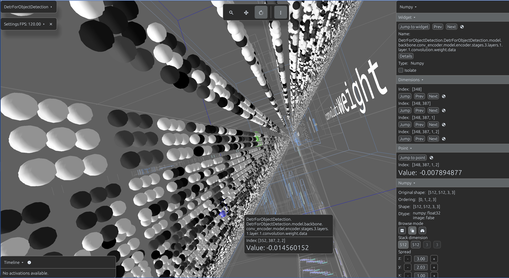

Online models are browsable at https://www.svetoviz.com.

---

## 10. Python App and Desktop App (OpenGL)

The Python OpenGL app provides a lightweight, local alternative for rapid inspection of tensors and modules without launching a web server.

### Local 2D rendering

The OpenGL application is written in pure **OpenGL**. While it focuses on clear perspective rather than the immersive 3D quality of the web interface, it is a great way to check your modules and weights directly on your desktop.

Download [`examples/quickstart_opengl.py`](examples/quickstart_opengl.py) for practical examples.

```bash
pip install svetoviz_opengl --extra-index-url https://svetoviz.com/opengl/simple/
```

**Compatibility:** macOS (Apple Silicon) and Python 3.9 through 3.12.

All WebGPU equivalents are also available in the Python OpenGL interface. Simply replace the import:

```python
import svetoviz_opengl as sv

# Load and View Scenes
sv.load_from_disc(directory="output/space_scene")
sv.view(layout)

# Basic Tensors
sv.array(tensor)
sv.arrays([t1, t2, t3])

# Neural Networks
sv.pytorch(module)
sv.model(hf_model)

# Computer Vision
sv.image(img)
sv.images(image_list)
```

| `sv.array()` | `sv.arrays()` |
|---|---|
| 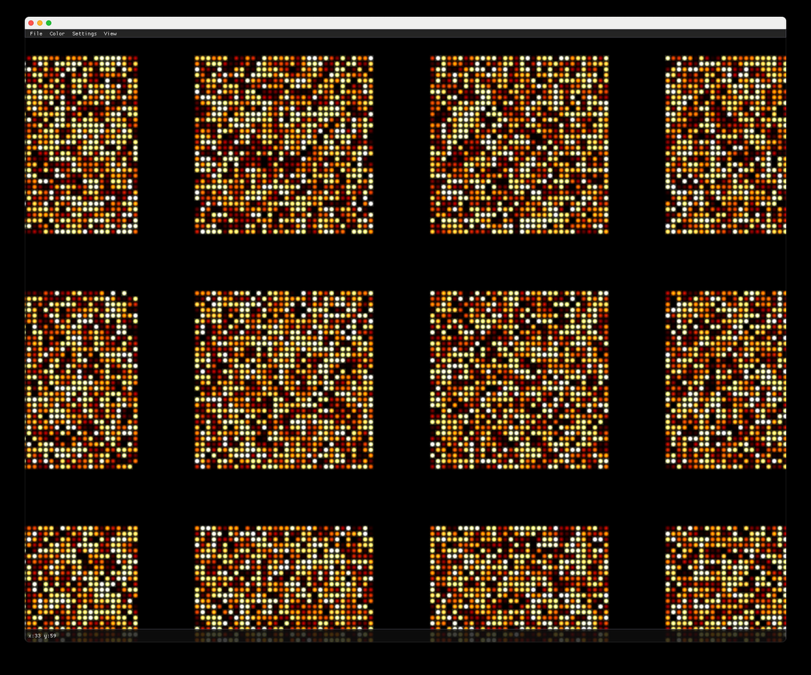 | 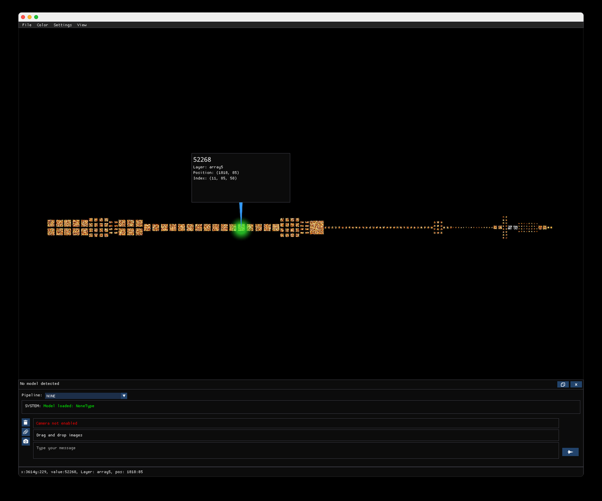 |
| `sv.image()` | `sv.images()` |
| 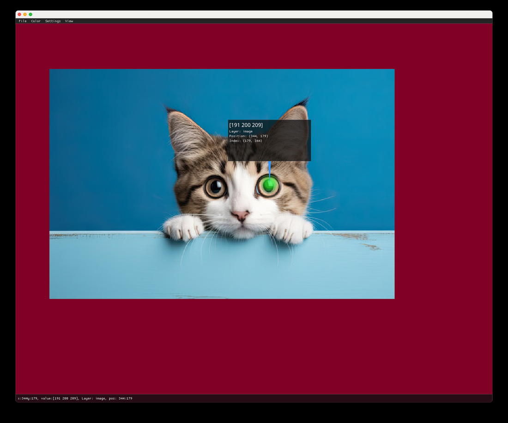 | 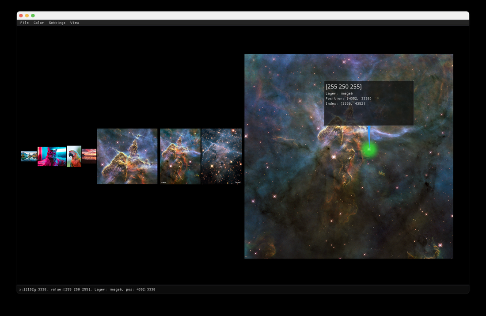 |

### Explicit layout control

For WebGPU you can control layout directly in the renderer. For the OpenGL app you control layout with additional arguments: `padding`, `spacing` and `gravity`.

```python
import svetoviz_opengl as sv

view = sv.GridLayout(
    id="layout",
    title="Grid Layout",
    padding="2%",
    title_color=(155, 155, 155),
    background_color=(0, 0, 0, 255),
    spacing=40,
    views=[
        sv.VerticalLayout(
            id="vertical1",
            title="np.float32",
            padding="5%",
            spacing="5%",
            background_color=(50, 50, 50, 255),
            views=[
                sv.NumpyView(
                    id="float32",
                    data=np.random.rand(
                        6, 24,
                        128, 32).astype(np.float32),
                    gap_size=10,
                    ordering=None)
            ]
        ),
        sv.VerticalLayout(
            id="vertical2",
            title="Images",
            padding="5%",
            spacing="5%",
            background_color=(50, 50, 50, 255),
            views=[
                sv.DiscImageView(
                    id="disc_image",
                    image=IMAGE_URL),
                sv.LazyImageView(
                    id="lazy_image",
                    image=IMAGE_URL)
            ]
        ),
        sv.VerticalLayout(
            id="float64_container",
            title="np.float64",
            padding="5%",
            background_color=(50, 50, 50, 255),
            views=[
                sv.NumpyView(
                    id="float64",
                    data=(np.random.uniform(
                        -1, 1,
                        (2, 32, 72, 24))
                          * 1.7976931348623157e+308).astype(np.float64),
                    gap_size=10,
                    ordering=None)
            ]
        ),
        sv.HorizontalLayout(
            id="vertical3",
            title="Integer",
            padding="5%",
            spacing="5%",
            gravity="center",
            background_color=(50, 50, 50, 255),
            views=[
                sv.VerticalLayout(
                    id="int8_container",
                    title="np.int8",
                    padding="5%",
                    background_color=(50, 50, 50, 255),
                    views=[
                        sv.NumpyView(
                            id="int8",
                            data=np.random.randint(
                                -128, 128,
                                (2, 2, 128, 128), dtype=np.int8),
                            gap_size=10,
                            ordering=None)
                    ]
                ),
                sv.VerticalLayout(
                    id="int32_container",
                    title="np.int32",
                    padding="5%",
                    background_color=(50, 50, 50, 255),
                    views=[
                        sv.NumpyView(
                            id="int32",
                            data=np.random.randint(
                                -2147483648, 2147483648,
                                (4, 4, 64, 64), dtype=np.int32),
                            gap_size=10,
                            ordering=None)
                    ]
                ),
            ]
        ),
    ],
)

sv.view(view=view)
```

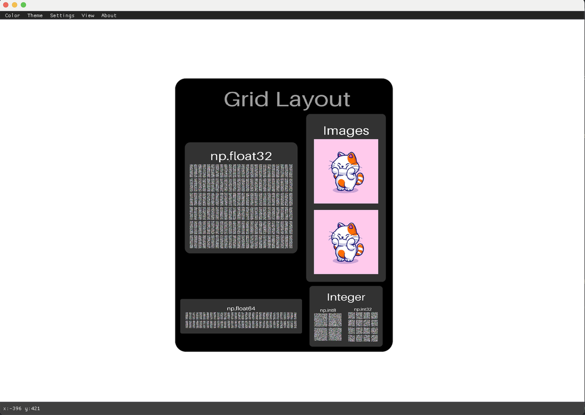

### Image layouts

```python
import svetoviz_opengl as sv

view = sv.DirectorySpiralView(
    directory="/Users/piotrgryko/Desktop/nasaimages",
    limit=200,
    lazy=False
)
sv.view(view)
```

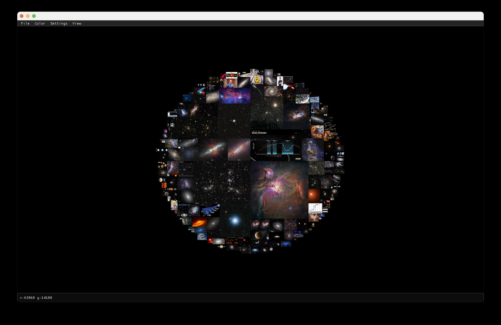

### Saving and loading

The OpenGL app allows for saving and opening directly from disc using `load_from_disc()` and `save_to_disc()`.

| Full collection saved to disc | Zoom down to pixel |
|---|---|
| 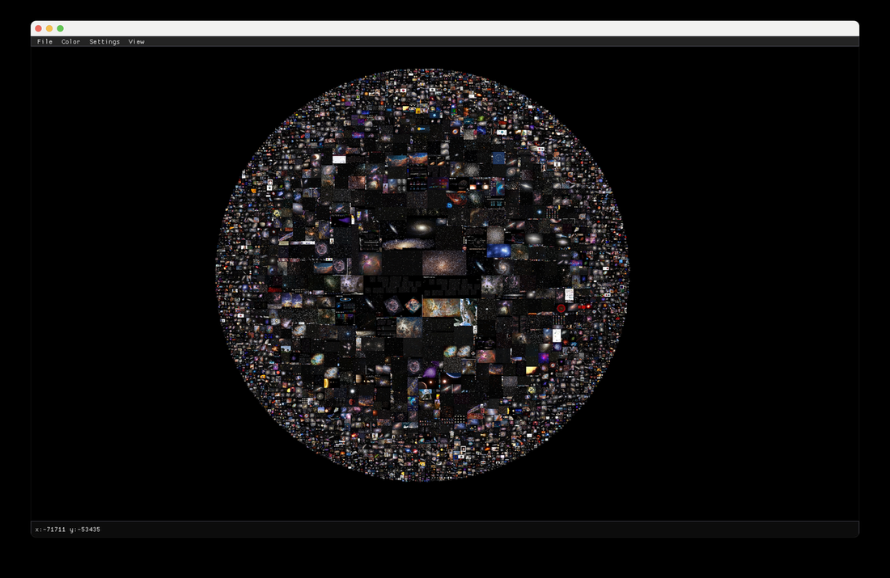 |  |

### Datasets

You can build and open your datasets the same as in the WebGPU app:

```python
import svetoviz_opengl as sv

hf_name = "Dewa/Dog_Emotion_Dataset_v2"
dataset = load_dataset(hf_name, split="train")

view = sv.DatasetView(
    name=hf_name,
    dataset=dataset,
    image_columns=["image"],
    cell_width=400,
    cell_height=400,
)

sv.save_to_disc(view=view,
                threaded=True,
                directory=output_directory,
                compression=CompressionMode.PNG_0,
                tree_db_only=False)
sv.load_from_disc(directory=output_directory)
```

| Dataset grid view | Dataset inspection |
|---|---|
|  |  |

### PyTorch module inspection

The OpenGL app is a great way to have a clear view over your PyTorch modules. To dive into the data, open the **Terminal View** to interact via callbacks, then use the **Timeline View** to inspect the resulting weights and states. OpenGL and WebGPU share a single mapping logic, so results are consistent across the two renderers.

```python
import svetoviz_opengl as sv

img = Image.open("sample_image.jpg").convert("RGB")
img_np = np.array(img).astype(np.float32) / 255.0
# Rearrange from (H, W, C) to (C, H, W) and add batch dim
input_tensor = torch.from_numpy(img_np).permute(2, 0, 1).unsqueeze(0)

# 2. Define the 2D Convolutional module
conv2d = nn.Conv2d(in_channels=3, out_channels=16, kernel_size=3, stride=1, padding=1)

def terminal_callback(buffer, message, images, files):
    # 3. Process the image through the module
    output = conv2d(input_tensor)

    # Log the feature map shape to the Svetoviz terminal
    buffer.send_system_message(f"Processed image. Shape: {list(output.shape)}")

# 4. Start the interactive session
sv.pytorch(module=conv2d, terminal_callback=terminal_callback)
```

| Interactive callback | Timeline view |
|---|---|
|  |  |
|  |  |
|  |  |
|  |  |

### Interactive models

The OpenGL app also lets you interact with a model similar to the web app. Load the model and use the **Terminal View** to run real-time queries.

| Model terminal | Model terminal |
|---|---|
|  |  |
|  |  |

---

## 11. PyTorch Modules and Debugger

Svetoviz provides native support for PyTorch modules. Your interaction activations are collected and presented on the screen, allowing for real-time inspection of data transformations.


**114 documented modules** are supported: 73 module pages plus 28 activation functions and 13 loss functions. Every module is traced through the same pipeline: input -> weights -> output, with the exact relation between a selected output value and the input values that produced it.

The three views below show that pipeline on `nn.Conv3d`. First the input volume is convolved by the learned kernel, producing a stack of spatial feature maps. Then each output value can be traced back to the exact input positions and kernel weights that produced it. Finally, the weights, bias, input and output tensors are inspected side by side for the selected value.


*`nn.Conv3d` feature maps - the input volume convolved with the learned kernel produces one spatial feature map per output channel.*


*`nn.Conv3d` value mapping - a selected output value is traced back to the input patch and the kernel weights that produced it.*


*`nn.Conv3d` bias and weight inspection - weights, bias, input and output tensors are shown side by side for the selected value.*

### Interactive modules

The `pytorch` interface wraps your `nn.Module` and provides a terminal for live interaction. This allows you to process data and inspect the resulting tensors without leaving the visualization environment.

```python
import svetoviz_webgpu as sv
import torch
import torch.nn as nn
from PIL import Image

# Prepare data
url = "https://cdn.freecodecamp.org/curriculum/cat-photo-app/relaxing-cat.jpg"
img = Image.open(requests.get(url, stream=True).raw).resize((64, 64))
img_np = np.array(img).transpose(2, 0, 1)
image_data = torch.from_numpy(img_np).float().unsqueeze(0)

# Your pytorch module
conv = nn.Conv2d(3, 4, 5, padding=10)

def terminal_callback(buffer, message, images, files):
    # Interact with the module as you normally do
    conv(image_data)
    buffer.send_system_message("processed")

# Start the session
sv.pytorch(module=conv, terminal_callback=terminal_callback)
```

### Layer relations

You can hover or click on output values to see the mappings and relations between layers. Svetoviz provides a visual explanation of the provenance for each value in the tensor.

For example, you can find the exact kernel position for convolutions, or visualize the column-to-patch mapping for operations like `fold` and `unfold`. Clicking an output value reveals the input-to-output spatial relationship.

### Module catalog

Each table lists the module, a one-line purpose and the parameters that matter most when inspecting it. The tables follow the documentation category order: convolution, pooling, padding, normalization, linear and embedding, dropout, shape and view, then activation functions, and loss functions last. Every module links to its illustrated guide on https://pytorch.svetoviz.com.

#### Convolution and transposed convolution (6)

| Module | Purpose | Key parameters |
|---|---|---|
| `nn.Conv1d` | 1-D convolution over signals `(N, C, L)` | `in_channels`, `out_channels`, `kernel_size`, `stride`, `padding`, `dilation`, `groups` |
| `nn.ConvTranspose1d` | Transposed 1-D convolution (learned upsampling) | `in_channels`, `out_channels`, `kernel_size`, `stride`, `padding`, `output_padding` |
| `nn.Conv2d` | 2-D convolution over images `(N, C, H, W)` | `in_channels`, `out_channels`, `kernel_size`, `stride`, `padding`, `groups` |
| `nn.ConvTranspose2d` | Transposed 2-D convolution (decoders, GANs) | `in_channels`, `out_channels`, `kernel_size`, `stride`, `padding`, `output_padding` |
| `nn.Conv3d` | 3-D convolution over volumes `(N, C, D, H, W)` | `in_channels`, `out_channels`, `kernel_size`, `stride`, `padding` |
| `nn.ConvTranspose3d` | Transposed 3-D convolution | `in_channels`, `out_channels`, `kernel_size`, `stride`, `padding` |

#### Pooling and unpooling (20)

| Module | Purpose | Key parameters |
|---|---|---|
| `nn.MaxPool1d` | Max pooling over 1-D signals | `kernel_size`, `stride`, `padding`, `dilation`, `return_indices` |
| `nn.MaxPool2d` | Max pooling over 2-D feature maps | `kernel_size`, `stride`, `padding`, `return_indices` |
| `nn.MaxPool3d` | Max pooling over 3-D volumes | `kernel_size`, `stride`, `padding`, `return_indices` |
| `nn.MaxUnpool1d` | Inverse of `MaxPool1d` using stored indices | `kernel_size`, `stride`, `padding` |
| `nn.MaxUnpool2d` | Inverse of `MaxPool2d` using stored indices | `kernel_size`, `stride`, `padding` |
| `nn.MaxUnpool3d` | Inverse of `MaxPool3d` using stored indices | `kernel_size`, `stride`, `padding` |
| `nn.AvgPool1d` | Average pooling over 1-D signals | `kernel_size`, `stride`, `padding`, `count_include_pad` |
| `nn.AvgPool2d` | Average pooling over 2-D feature maps | `kernel_size`, `stride`, `padding`, `count_include_pad` |
| `nn.AvgPool3d` | Average pooling over 3-D volumes | `kernel_size`, `stride`, `padding`, `count_include_pad` |
| `nn.LPPool1d` | Lp-norm pooling over 1-D signals | `norm_type`, `kernel_size`, `stride` |
| `nn.LPPool2d` | Lp-norm pooling over 2-D feature maps | `norm_type`, `kernel_size`, `stride` |
| `nn.LPPool3d` | Lp-norm pooling over 3-D volumes | `norm_type`, `kernel_size`, `stride` |
| `nn.AdaptiveMaxPool1d` | Max pool to a fixed output length | `output_size`, `return_indices` |
| `nn.AdaptiveMaxPool2d` | Max pool to a fixed output grid | `output_size`, `return_indices` |
| `nn.AdaptiveMaxPool3d` | Max pool to a fixed output volume | `output_size`, `return_indices` |
| `nn.AdaptiveAvgPool1d` | Average pool to a fixed output length | `output_size` |
| `nn.AdaptiveAvgPool2d` | Average pool to a fixed output grid | `output_size` |
| `nn.AdaptiveAvgPool3d` | Average pool to a fixed output volume | `output_size` |
| `nn.FractionalMaxPool2d` | Random-step max pooling with fractional coverage | `kernel_size`, `output_ratio` / `output_size` |
| `nn.FractionalMaxPool3d` | 3-D fractional max pooling | `kernel_size`, `output_ratio` / `output_size` |

#### Padding (15)

| Module | Purpose | Key parameters |
|---|---|---|
| `nn.ReflectionPad1d` | Reflects the signal at the border (1-D) | `padding` |
| `nn.ReflectionPad2d` | Reflects the image at the border (2-D) | `padding` |
| `nn.ReflectionPad3d` | Reflects the volume at the border (3-D) | `padding` |
| `nn.ReplicationPad1d` | Repeats edge values (1-D) | `padding` |
| `nn.ReplicationPad2d` | Repeats edge values (2-D) | `padding` |
| `nn.ReplicationPad3d` | Repeats edge values (3-D) | `padding` |
| `nn.ZeroPad1d` | Zero padding (1-D) | `padding` |
| `nn.ZeroPad2d` | Zero padding (2-D) | `padding` |
| `nn.ZeroPad3d` | Zero padding (3-D) | `padding` |
| `nn.ConstantPad1d` | Constant-value padding (1-D) | `padding`, `value` |
| `nn.ConstantPad2d` | Constant-value padding (2-D) | `padding`, `value` |
| `nn.ConstantPad3d` | Constant-value padding (3-D) | `padding`, `value` |
| `nn.CircularPad1d` | Wraps the signal around (1-D) | `padding` |
| `nn.CircularPad2d` | Wraps the image around (2-D) | `padding` |
| `nn.CircularPad3d` | Wraps the volume around (3-D) | `padding` |

#### Normalization (9)

| Module | Purpose | Key parameters |
|---|---|---|
| `nn.BatchNorm1d` | Normalizes per channel across a batch (1-D) | `num_features`, `eps`, `momentum`, `affine`, `track_running_stats` |
| `nn.BatchNorm2d` | Normalizes per channel across a batch (2-D) | `num_features`, `eps`, `momentum`, `affine` |
| `nn.BatchNorm3d` | Normalizes per channel across a batch (3-D) | `num_features`, `eps`, `momentum`, `affine` |
| `nn.InstanceNorm1d` | Normalizes each sample independently (1-D) | `num_features`, `eps`, `momentum`, `affine`, `track_running_stats` |
| `nn.InstanceNorm2d` | Normalizes each sample independently (2-D) | `num_features`, `eps`, `momentum`, `affine` |
| `nn.InstanceNorm3d` | Normalizes each sample independently (3-D) | `num_features`, `eps`, `momentum`, `affine` |
| `nn.LayerNorm` | Normalizes over the trailing normalized shape | `normalized_shape`, `eps`, `elementwise_affine` |
| `nn.GroupNorm` | Splits channels into groups and normalizes each | `num_groups`, `num_channels`, `eps`, `affine` |
| `nn.LocalResponseNorm` | Lateral inhibition across neighbouring channels | `size`, `alpha`, `beta`, `k` |

#### Linear, bilinear, embeddings and similarity (6)

| Module | Purpose | Key parameters |
|---|---|---|
| `nn.Linear` | Fully connected transform `y = xA^T + b` | `in_features`, `out_features`, `bias` |
| `nn.Bilinear` | Bilinear combination of two inputs | `in1_features`, `in2_features`, `out_features`, `bias` |
| `nn.Embedding` | Lookup table mapping indices to vectors | `num_embeddings`, `embedding_dim`, `padding_idx`, `max_norm` |
| `nn.EmbeddingBag` | Embedding lookup with on-the-fly reduction | `num_embeddings`, `embedding_dim`, `mode` (`mean` / `sum` / `max`) |
| `nn.CosineSimilarity` | Cosine similarity along a dimension | `dim`, `eps` |
| `nn.PairwiseDistance` | p-norm distance between two batches | `p`, `eps`, `keepdim` |

#### Dropout (6)

| Module | Purpose | Key parameters |
|---|---|---|
| `nn.Dropout` | Randomly zeroes elements during training | `p`, `inplace` |
| `nn.Dropout1d` | Drops entire 1-D channels | `p`, `inplace` |
| `nn.Dropout2d` | Drops entire feature maps | `p`, `inplace` |
| `nn.Dropout3d` | Drops entire volumetric channels | `p`, `inplace` |
| `nn.AlphaDropout` | Self-normalizing dropout for SELU networks | `p`, `inplace` |
| `nn.FeatureAlphaDropout` | Channel-wise AlphaDropout | `p`, `inplace` |

#### Shape, view and reordering (11)

| Module | Purpose | Key parameters |
|---|---|---|
| `nn.Unfold` | Extracts sliding local blocks into columns | `kernel_size`, `dilation`, `padding`, `stride` |
| `nn.Fold` | Combines sliding local blocks back into a tensor | `output_size`, `kernel_size`, `dilation`, `padding`, `stride` |
| `nn.Flatten` | Flattens a contiguous range of dimensions | `start_dim`, `end_dim` |
| `nn.Unflatten` | Expands one dimension into a shape | `dim`, `unflattened_size` |
| `nn.PixelShuffle` | Rearranges `(*, C*r^2, H, W)` into `(*, C, H*r, W*r)` | `upscale_factor` |
| `nn.PixelUnshuffle` | Inverse rearrangement of `PixelShuffle` | `downscale_factor` |
| `nn.Upsample` | Generic resampling of spatial dimensions | `size` / `scale_factor`, `mode`, `align_corners` |
| `nn.UpsamplingNearest2d` | Nearest-neighbour upsampling, deprecated alias | `size` / `scale_factor` |
| `nn.UpsamplingBilinear2d` | Bilinear upsampling, deprecated alias | `size` / `scale_factor` |
| `nn.ChannelShuffle` | Interleaves channels between groups | `groups` |
| `nn.Identity` | Pass-through, useful as a breakpoint placeholder | none |

#### Activation functions (28)

```python
import svetoviz_webgpu as sv

def demo_activation():
    input_tensor = torch.from_numpy(img_np)\
        .view(1, 1, height, width)\
        .repeat(1, 2, 1, 1)

    activations = nn.ModuleDict({
        "ReLU": nn.ReLU(),
        "LeakyReLU": nn.LeakyReLU(negative_slope=0.02),
        "PReLU": nn.PReLU(num_parameters=2),
        "GELU": nn.GELU(),
        "SiLU": nn.SiLU(),
        "Mish": nn.Mish(),
        "Hardswish": nn.Hardswish(),
        "Sigmoid": nn.Sigmoid(),
        "Tanh": nn.Tanh(),
        "Softmax": nn.Softmax(dim=1),
        "LogSoftmax": nn.LogSoftmax(dim=-1),
        "ELU": nn.ELU(),
        "SELU": nn.SELU(),
        "Softplus": nn.Softplus(),
        "Threshold": nn.Threshold(threshold=0.1, value=-2.0),
        "Softshrink": nn.Softshrink(lambd=0.5),
        "GLU": nn.GLU(dim=1),
        "Hardshrink": nn.Hardshrink(lambd=0.5),
        "Hardsigmoid": nn.Hardsigmoid(),
        "Hardtanh": nn.Hardtanh(min_val=-1.0, max_val=1.0),
        "LogSigmoid": nn.LogSigmoid(),
        "ReLU6": nn.ReLU6(),
        "RReLU": nn.RReLU(),
        "CELU": nn.CELU(),
        "Softsign": nn.Softsign(),
        "Tanhshrink": nn.Tanhshrink(),
        "Softmin": nn.Softmin(dim=1),
        "Softmax2d": nn.Softmax2d()
    })

    def terminal_callback(buffer, message, images, files):
        for name, module in activations.items():
            output = module(input_tensor)
            buffer.send_system_message(f"Applied {name}: Output shape {list(output.shape)}")

    sv.pytorch(module=activations, terminal_callback=terminal_callback)
```

| Module | Purpose | Key parameters |
|---|---|---|
| `nn.ReLU` | Half-wave rectifier, `max(0, x)` | `inplace` |
| `nn.LeakyReLU` | ReLU with a small negative slope | `negative_slope`, `inplace` |
| `nn.PReLU` | ReLU with a learned negative slope | `num_parameters`, `init` |
| `nn.GELU` | Gaussian error linear unit | `approximate` (`none` / `tanh`) |
| `nn.SiLU` | Sigmoid-weighted linear unit (Swish) | `inplace` |
| `nn.Mish` | Smooth non-monotonic activation | `inplace` |
| `nn.Hardswish` | Piecewise-linear approximation of SiLU | `inplace` |
| `nn.Sigmoid` | Logistic squashing to `(0, 1)` | none |
| `nn.Tanh` | Hyperbolic tangent, zero-centred | none |
| `nn.Softmax` | Normalizes values into a probability simplex | `dim` |
| `nn.LogSoftmax` | Log of the softmax, numerically stable | `dim` |
| `nn.Softmin` | Softmax over negated inputs | `dim` |
| `nn.Softmax2d` | Softmax over each spatial location | none |
| `nn.ELU` | Exponential linear unit | `alpha`, `inplace` |
| `nn.SELU` | Self-normalizing exponential unit | `inplace` |
| `nn.CELU` | Continuously differentiable exponential unit | `alpha`, `inplace` |
| `nn.Softplus` | Smooth approximation of ReLU | `beta`, `threshold` |
| `nn.Softsign` | `x / (1 + abs(x))`, a smooth squashing curve | none |
| `nn.Tanhshrink` | `x - tanh(x)` | none |
| `nn.Threshold` | Hard threshold with a replacement value | `threshold`, `value` |
| `nn.Softshrink` | Soft thresholding, used in sparse coding | `lambd` |
| `nn.Hardshrink` | Hard thresholding | `lambd` |
| `nn.Hardsigmoid` | Piecewise-linear sigmoid | `inplace` |
| `nn.Hardtanh` | Clamps values into a fixed interval | `min_val`, `max_val` |
| `nn.LogSigmoid` | Log of the sigmoid | none |
| `nn.ReLU6` | ReLU capped at 6 | `inplace` |
| `nn.RReLU` | Randomized leaky ReLU during training | `lower`, `upper`, `inplace` |
| `nn.GLU` | Gated linear unit over a split dimension | `dim` |

#### Loss functions (13)

```python
import svetoviz_webgpu as sv

def demo_loss():
    losses = nn.ModuleDict({
        "L1": nn.L1Loss(),
        "MSE": nn.MSELoss(),
        "SmoothL1": nn.SmoothL1Loss(),
        "Huber": nn.HuberLoss(delta=1.0),
        "CrossEntropy": nn.CrossEntropyLoss(),
        "BCEWithLogits": nn.BCEWithLogitsLoss(),
        "KLDiv": nn.KLDivLoss(reduction="batchmean"),
        "PoissonNLL": nn.PoissonNLLLoss(),
        "MultiLabelSoftMargin": nn.MultiLabelSoftMarginLoss(),
        "MarginRanking": nn.MarginRankingLoss(margin=0.0),
        "CosineEmbedding": nn.CosineEmbeddingLoss(margin=0.0),
        "TripletMargin": nn.TripletMarginLoss(margin=1.0, p=2.0),
        "TripletMarginWithDistance": nn.TripletMarginWithDistanceLoss()
    })

    def terminal_callback(buffer, message, images, files):
        for name in losses:
            buffer.send_system_message(f"Loaded {name}")

    sv.pytorch(module=losses, terminal_callback=terminal_callback)
```

| Module | Purpose | Key parameters |
|---|---|---|
| `nn.L1Loss` | Mean absolute error | `reduction` |
| `nn.MSELoss` | Mean squared error | `reduction` |
| `nn.SmoothL1Loss` | Quadratic near zero, linear in the tails | `beta`, `reduction` |
| `nn.HuberLoss` | Huber combination of L1 and L2 | `delta`, `reduction` |
| `nn.CrossEntropyLoss` | Log-softmax followed by NLL for class logits | `weight`, `ignore_index`, `label_smoothing` |
| `nn.BCEWithLogitsLoss` | Sigmoid plus binary cross entropy, numerically stable | `weight`, `pos_weight`, `reduction` |
| `nn.KLDivLoss` | Kullback-Leibler divergence between distributions | `reduction` (`batchmean` for true KL) |
| `nn.PoissonNLLLoss` | Negative log likelihood of a Poisson target | `log_input`, `full`, `eps` |
| `nn.MultiLabelSoftMarginLoss` | One-vs-all logistic loss for multi-label targets | `weight`, `reduction` |
| `nn.MarginRankingLoss` | Ranking loss with a margin between pairs | `margin`, `reduction` |
| `nn.CosineEmbeddingLoss` | Cosine distance with a target label of `1` or `-1` | `margin`, `reduction` |
| `nn.TripletMarginLoss` | Anchor / positive / negative embedding separation | `margin`, `p`, `eps`, `swap` |
| `nn.TripletMarginWithDistanceLoss` | Triplet loss with a pluggable distance function | `distance_function`, `margin`, `swap` |

Browse every module screenshot and per-module walkthrough at **https://pytorch.svetoviz.com**.

---

## 12. Try Svetoviz Now

Everything in this README runs in the live viewer. You do not need to install anything to look at the
public scenes, module walkthroughs and published datasets.

| Destination | What is there |
|---|---|
| **https://www.svetoviz.com** | Product overview, the public 3D scene directory |
| **https://www.svetoviz.com/docs** | The full manuals and guides mirrored by this README |
| **https://pytorch.svetoviz.com** | Illustrated per-module guides for all 114 PyTorch modules |
| **https://app.svetoviz.com** | Dataset scenes published online, browsable in the browser |

<div align="center">

**[Open Svetoviz - www.svetoviz.com](https://www.svetoviz.com)**

[](https://www.svetoviz.com)

</div>

---

## 13. Documentation Index

The written guides published on the website, in the same order as this README:

| Guide | Covers | Link |
|---|---|---|
| Overview | What Svetoviz is, the visual-debugger concept, supported data types | https://www.svetoviz.com/docs |
| Installation | Both packages, dependency lists, single-environment setup, demos | https://www.svetoviz.com/docs/install |
| API Reference | Full signatures and parameters for every method, view, layout, remote view and utility | https://www.svetoviz.com/docs/docs |
| Images | `image` / `images` polymorphism, batch inspection, cache configuration | https://www.svetoviz.com/docs/images |
| NumPy | Single array inspection, stacking, colormaps, mixed dtypes, axis ordering, large high-dimensional arrays | https://www.svetoviz.com/docs/numpy |
| Datasets | Building and launching a dataset scene, search database, compression levels | https://www.svetoviz.com/docs/datasets |
| Views | `View` vs `Layout`, directory views, layout nesting, offline scene building | https://www.svetoviz.com/docs/views |
| torch.Tensor | Single tensor inspection, mixed dtypes, stacking, ordering, large tensors | https://www.svetoviz.com/docs/tensor |
| Models | `model()` vs `pipeline()`, terminal callbacks, non-blocking mode, diffusion pipelines | https://www.svetoviz.com/docs/models |
| Desktop App | OpenGL specifics: local rendering, explicit layout control, image layouts, saving / loading, datasets, module and model inspection | https://www.svetoviz.com/docs/pythonapp |
| PyTorch | Wrapping `nn.Module`, the interaction terminal, layer relations and provenance mapping | https://www.svetoviz.com/docs/pytorch |
| PyTorch Modules | The illustrated module catalog (114 modules) | https://pytorch.svetoviz.com |
| Activation functions | All 28 supported activation modules | https://www.svetoviz.com/docs/activations |
| Loss functions | All 13 supported loss modules | https://www.svetoviz.com/docs/loss |

### Video demos

| Demo | Link |
|---|---|
| NumPy array inspection | https://www.youtube.com/watch?v=fWhK4oPcSf0 |
| `torch.Tensor` inspection | https://www.youtube.com/watch?v=IijSmLB1FgY |
| PyTorch Debugger | https://www.youtube.com/watch?v=JGBud9nniOM |
| Model analysis (DETR) | https://www.youtube.com/watch?v=SPCUtlT1298 |
| Model debugger (GPT-2) | https://www.youtube.com/watch?v=LJa9MFEWcWE |
| Dataset explorer | https://www.youtube.com/watch?v=DEuSVW1oJG4 |
| Image browser | https://www.youtube.com/watch?v=xHb_U8BAsEs |

---

## 14. Links

- **Website / public directory:** https://www.svetoviz.com
- **Documentation:** https://www.svetoviz.com/docs
- **PyTorch module guides:** https://pytorch.svetoviz.com
- **Online datasets:** https://app.svetoviz.com
- **OpenGL wheel index:** https://svetoviz.com/opengl/simple/
- **WebGPU wheel index:** https://svetoviz.com/webgpu/simple/
- **Author - LinkedIn:** https://www.linkedin.com/in/piotr-gryko-946756101/
- **Author - GitHub:** https://github.com/PiotrGryko

---

## 15. About

**Svetoviz Research** - advancing high-dimensional data visualization and machine learning interpretability.

```
Piotr Gryko
ul. Prezydenta Ryszarda Kaczorowskiego 14 / 271
15-375 Bialystok, Poland

NIP:   9662022689
REGON: 368029613
```

Registered in Bialystok, Poland.

<div align="center">

**[www.svetoviz.com](https://www.svetoviz.com)** | **[Documentation](https://www.svetoviz.com/docs)** | **[PyTorch Debugger](https://pytorch.svetoviz.com)**

<p>Built for the Global AI Research Community.</p>

</div>

---

<div align="center">

**Start visualizing - [open the live Svetoviz viewer](https://www.svetoviz.com)**

[](https://www.svetoviz.com)

**https://www.svetoviz.com** - documentation, install commands and the public model / dataset browser.

</div>
